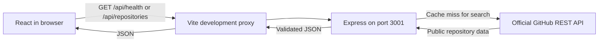

# OpenSource Explorer

[Central phase progress and evidence](docs/PHASE_PROGRESS.md) is the permanent project journal. [Current status](docs/PROJECT_STATUS.md) is the short snapshot. Phase 5 engineering is being verified; deployment and stack merges require separate approval.

A student full-stack learning project built with AI assistance and code review. The planned product helps people discover public GitHub repositories. **Phase 4 adds shareable repository details and a bounded list of public contribution issues, alongside working search, filtering, and pagination.**

## What works

- Responsive React homepage with controlled search/language/sort/order/page-size inputs, repository cards, and bounded pagination.
- Loading, empty, validation, safe error/retry, and rate-limit cooldown states; superseded searches are cancelled and ignored.
- Real backend connection check, response validation, five-second timeout, and retry.
- Express `GET /api/health`, structured 404/500 responses, and validated `PORT` configuration.
- Shareable `/repositories/:owner/:repo` pages with detail loading, errors, manual retry, safe external links, and contribution-label filters.
- Validated backend search/details/issues, explicit PR exclusion, safe upstream errors, request timeout, public-visibility checks, and a shared bounded TTL cache.
- npm workspaces, TypeScript, formatting, linting, unit/integration tests, and Chromium browser tests.

No database, authentication, GitHub token, paid API, hosted service, deployment, or GitHub Actions workflow is configured.

## Cloud development

All commands below are for Codex Cloud; students can ask Codex to run them from Android. No local terminal is required. Use Node.js 24.x and npm 11.x (verified: Node 24.19.0, npm 11.9.0).

```sh
cd /workspace/new-project-reactjs-nodejs
npm ci --cache /tmp/opensource-npm-cache
NODE_USE_ENV_PROXY=1 npm run dev
```

The writable cache path avoids the restricted home directory in this environment. `NODE_USE_ENV_PROXY=1` enables Node 24 to use the cloud-provided HTTP(S) proxy for GitHub requests while preserving TLS verification. It is a cloud runtime setting, not a credential; no token is required by the app. The frontend listens on port 5173 and proxies `/api` requests to port 3001. These are internal development addresses, not a public deployment. Stop both processes with Ctrl+C in the managing cloud process. `concurrently -k` stops the sibling process when one exits.

`PORT=4000 npm run dev -w backend` changes the backend port. If using the frontend with a changed backend port, update the proxy target in `frontend/vite.config.ts` too. `backend/.env.example` documents the setting; it is not loaded automatically. Set `PORT` in the process environment. No secrets are needed.

## Commands

| Command                                            | Purpose                                              |
| -------------------------------------------------- | ---------------------------------------------------- |
| `npm run dev`                                      | Start frontend and backend watchers                  |
| `npm run check`                                    | Formatting, lint, type checks, 214 tests, and builds |
| `npm run format`                                   | Format source and documentation                      |
| `npm run test:e2e`                                 | Run thirteen browser tests; starts/stops dev servers |
| `CHROMIUM_PATH=/usr/bin/chromium npm run test:e2e` | Use this cloud environment's installed Chromium      |
| `npm run build`                                    | Emit frontend assets and backend JavaScript          |
| `npm run start -w backend`                         | Run compiled backend after building                  |

Browser tests use Playwright. Without a system Chromium, its matching browser must be installed in the cloud environment before running tests. Tests cover 390px and 1280px widths, real health and backend validation responses, deterministic search fixtures, filters/pagination, cooldowns, failure/retry, keyboard focus, overflow, and axe accessibility checks. Routine checks do not call GitHub. Details tests additionally cover direct URLs, refresh/back/forward, issue filters, not-found and cooldown states, and safe links. Automated checks do not replace manual assistive-technology testing or physical Android testing.

## Health contract

```http
GET /api/health
HTTP/1.1 200 OK
Content-Type: application/json
Cache-Control: no-store
```

```json
{ "status": "ok", "service": "opensource-explorer-api" }
```

Health indicates this Express process responds. It does not check GitHub availability or future dependencies. The UI checks on mount and manual retry, not continuously.

## Architecture and files

```text
frontend/
  src/                 React UI, health client, styles, component tests
    search/            Search form/hook/cards and shared typed JSON transport
    details/           Detail/issue client, resource hooks, page, fixtures, tests
    routing.tsx        Small History API router and internal links
  index.html           Accessible document entry
  vite.config.ts       React plugin, API proxy, test setup
  tsconfig.json
  package.json
backend/
  src/
    app.ts             Express factory and error middleware
    config.ts          Port validation
    server.ts          Listener and shutdown handling
    app.test.ts        Foundation API and configuration tests
    github/client.ts   GitHub HTTP client and safe upstream error mapping
    repositories/     Routes, validation, mapping, service, cache, errors, tests
  .env.example
  tsconfig.json
  tsconfig.build.json
  package.json
docs/
  learning/LESSON_01_FOUNDATION.md
  learning/LESSON_02_GITHUB_API.md
  learning/LESSON_03_REACT_SEARCH.md
  learning/LESSON_04_REPOSITORY_DETAILS.md
  PHASE_1_VERIFICATION.md
  PHASE_2_VERIFICATION.md
  PHASE_3_VERIFICATION.md
  PHASE_4_VERIFICATION.md
  screenshots/         Mobile/desktop screenshots using deterministic test data
  PROJECT_STATUS.md
scripts/smoke-github.mjs
scripts/smoke-issues.mjs
tests/foundation.spec.ts
tests/search.spec.ts
tests/details.spec.ts
AGENTS.md
README.md
package.json
package-lock.json
playwright.config.ts
eslint.config.js
tsconfig.base.json
.prettierrc.json
.prettierignore
.gitignore
```

Learning materials live in `docs/learning/` rather than a duplicate root `learning/` folder.



Production builds are verified, but production routing and hosting are deferred. The Vite proxy is development-only; a future deployment needs same-origin `/api` routing or an explicitly configured API origin and restrictive CORS. The backend currently serves JSON only, not frontend assets.

## Quality, cost, and learning

See [project status](docs/PROJECT_STATUS.md), [Phase 4 verification](docs/PHASE_4_VERIFICATION.md), and [Lesson 4](docs/learning/LESSON_04_REPOSITORY_DETAILS.md). [Phase 3 verification](docs/PHASE_3_VERIFICATION.md) and [Lesson 3](docs/learning/LESSON_03_REACT_SEARCH.md) record the search implementation. [Phase 2 verification](docs/PHASE_2_VERIFICATION.md) and [Lesson 2](docs/learning/LESSON_02_GITHUB_API.md) explain the search/detail backend extended by Phase 4. [Phase 1 verification](docs/PHASE_1_VERIFICATION.md) and [Lesson 1](docs/learning/LESSON_01_FOUNDATION.md) remain historical foundation references. All selected libraries are free and open source. No external billable services were activated. Hosting terms and Actions eligibility must be verified before those later phases. The application sends no Authorization header. Live cloud responses may reflect platform proxy credentials; observed quotas must not be presented as the public unauthenticated allowance.

Review each phase in a feature branch/PR. Merging requires the student's approval. Contributions and learning claims should accurately acknowledge AI-assisted implementation and distinguish reading, modifying, and independently writing code.

## Phase 2 backend API

`GET /api/repositories?q=react&language=TypeScript&sort=stars&order=desc&page=1&per_page=20`

| Parameter  | Rules and defaults                                                                                                                                                             |
| ---------- | ------------------------------------------------------------------------------------------------------------------------------------------------------------------------------ |
| `q`        | Required, trimmed, whitespace collapsed; 1–200 characters. Control characters and qualifier colons are rejected; this is text search, not a full GitHub advanced-query editor. |
| `language` | Optional; 1–50 letters, digits, spaces, or `. + # -`; trimmed and lowercased. Empty values are invalid.                                                                        |
| `sort`     | `best-match` (default), `stars`, `forks`, or `updated`; best match omits GitHub's sort parameter.                                                                              |
| `order`    | `desc` (default) or `asc`; GitHub controls relevance ordering for best match.                                                                                                  |
| `page`     | Positive integer, default 1; cannot exceed `floor(1000 / effective_per_page)`.                                                                                                 |
| `per_page` | Positive safe integer, default 20, capped at 50; response reports the effective value.                                                                                         |

Unknown or repeated query parameters are rejected. Inputs never enter HTTP headers. The service appends `is:public` and the validated language qualifier, using `URL` and `URLSearchParams` for encoding.

Search returns `{ repositories: [...], pagination: {...} }`. Detail at `GET /api/repositories/:owner/:repo` returns `{ repository: {...} }`. Owners must match GitHub's alphanumeric/hyphen username shape (1–39 characters, no leading/trailing/consecutive hyphens). Repository names allow letters, digits, `.`, `_`, `-`, up to 100 characters; `.` and `..` are invalid. Detail lookup normalizes case. Malformed URL encoding is a 400.

Each repository has exactly `name`, `owner` (login string), `description`, `language`, `stars`, `forks`, `open_issues`, and `url`. Description/language may be null. GitHub's `open_issues_count` includes pull requests; this is not a promise of issue-only counts. Non-public or malformed upstream records are rejected. Browser-facing repository URLs must be HTTPS GitHub URLs matching the returned owner/name.

Pagination contains `page`, `per_page`, `total_count`, `accessible_pages`, `has_next_page`, `search_limit` (1000), `truncated`, and `incomplete_results`. GitHub's total is a snapshot, not a guarantee of retrievable/stable results. `accessible_pages` is bounded by both reported total and `floor(1000 / per_page)`; for 30 per page, only 33 full pages (990 slots) are addressable by this API. `truncated` says the reported total exceeds those slots. `has_next_page` also requires a full current page; it is guidance, not a guarantee. `incomplete_results` independently reports GitHub search incompleteness. A valid page beyond the actual result count may return an empty list.

### Failures and resource limits

| HTTP | Meaning                                                                     |
| ---- | --------------------------------------------------------------------------- |
| 400  | Invalid inputs or GitHub 422 rejection; simplify the query/check pagination |
| 404  | Public repository missing, or unknown application route                     |
| 429  | Primary/secondary rate limit; wait before retrying                          |
| 502  | Network failure, invalid GitHub JSON/data, or another upstream failure      |
| 503  | GitHub maintenance or non-rate-limit access restriction                     |
| 504  | GitHub timeout, including a slow response body                              |
| 500  | Unexpected internal application error                                       |

Errors use `{ error: { code, message, retry_after_seconds?, rate_limit_reset? } }`. Known rate limits return a numeric `Retry-After` header, falling back to 60 seconds if unavailable; guidance is bounded to 1–86400 seconds. A valid reset value is a Unix timestamp in seconds. Maintenance retry guidance is forwarded when available. Original upstream messages/headers are not blindly echoed. The application makes no automatic retries or polling requests.

`GITHUB_TIMEOUT_MS` defaults to 5000 and accepts integers 100–30000. Set it in the process environment; `.env.example` documents it but is not automatically loaded. The API version is pinned to `2022-11-28` with fixed Accept/User-Agent headers. Redirects fail closed instead of forwarding requests to other destinations.

The process-local cache stores only successful, fully validated results for 60 seconds, up to 100 entries shared across search/detail. Keys are normalized complete API URLs. Reads do not refresh expiry; oldest inserted entries are evicted at capacity and expired entries are pruned on reads/writes. It resets on restart and is not shared between processes. Empty search results can be cached; errors cannot. Simultaneous misses are not coalesced, and there is no distributed quota coordination. Responses use `Cache-Control: no-store`; the internal cache is separate from browser caching.

The public unauthenticated API generally permits 60 requests/hour/IP, with a separate tighter search quota. Shared cloud IPs and secondary limits can reduce availability. No paid quota upgrade, PAT, OAuth, database, or hosting was added. See the official [GitHub rate-limit documentation](https://docs.github.com/en/rest/using-the-rest-api/rate-limits-for-the-rest-api); actual headers govern observed availability.

For an optional **manual** cloud smoke test after building:

```sh
NODE_USE_ENV_PROXY=1 node scripts/smoke-github.mjs
```

This makes at most two GitHub requests, checks live search/details, and verifies a cached repeat. It is not part of ordinary automated tests. Tests remain fully mocked when GitHub is unreachable. A proxy 403 before HTTP reaches GitHub is an environment-access problem: from Android Chrome, review environment network settings for `api.github.com` and save/publish changes as required. Do not paste credentials into chat or disable TLS. During Phase 2, GitHub API calls succeeded although environment metadata reported unknown enforcement; Phase 3 did not repeat live search calls.

Phase 2 is stacked on the unmerged `feat/phase-1-foundation` branch (PR #1). Review its PR against that branch to see only Phase 2 changes. After Phase 1 is approved/merged, retarget Phase 2 to `main` and verify the resulting diff before any separate merge approval.

## Phase 3: using repository search

Enter a name or topic and optionally choose a language, sort, order, and 10/20/50 results per page. Press Enter in the search field or press Search. Editing controls alone makes no search requests. Best match uses GitHub's relevance ordering; other sorts honor the selected order.

The page clearly identifies the last submitted query/filters/page. Changing a filter disables old pagination/retry until you submit the new search, which starts at page 1. During loading, duplicate submissions are blocked; changing the draft allows a replacement search. Old requests are aborted and their late results ignored. Pagination places keyboard focus on the results heading.

Cards show owner/name, description, language, stars, forks, and GitHub's combined open issue/PR count. Missing descriptions/languages are explicit. Repository links open GitHub in a new tab with safe `rel` attributes. The Phase 4 View details link opens the in-app repository page; the distinct GitHub link remains available.

The browser calls only the relative `/api/repositories` endpoint using URLSearchParams, never `api.github.com`. The API client checks JSON object/array shapes, nullable strings, nonnegative counts, boolean pagination flags, matching page/page-size, the 1000-result window, and safe HTTPS GitHub repository URLs. TypeScript types alone are not treated as runtime validation. Extra fields are discarded; this is a deliberately small parser, not a general schema framework.

The client has a 10-second deadline covering response/body parsing, separate from the backend's configurable timeout. It shows safe local messages for HTTP errors, malformed responses, network failure, and timeout. It never renders upstream HTML or arbitrary error messages. HTTP 429 pauses all search/retry requests until the latest valid Retry-After/body retry/reset hint (60 seconds if missing); HTTP 503 honors provided hints too. A local timer reenables controls but does not send requests. Cooldown is per mounted page, not persistent or a server-wide quota mechanism.

Search totals may change. Truncation and incomplete-result warnings remain visible. Previous/Next obey both backend `has_next_page` and the accessible-page boundary; the UI does not claim that all reported matches can be fetched.

[Mobile screenshot](docs/screenshots/phase-3-mobile.png) · [Desktop screenshot](docs/screenshots/phase-3-desktop.png). These show **deterministic test data**, not a live GitHub search, and the visible keyboard focus outline after pagination.

Phase 3 search work is tracked by PR #5 on `feat/phase-3-search-ui`, based on `feat/phase-2-github-api`. Phase 4 now extends that unmerged branch; dependency PRs remain separately reviewable.

## Phase 4: details and contribution opportunities

Select **View details** on a repository card or open `/repositories/:owner/:repo` directly. A small router uses the browser History API; normal internal clicks update the page without reloading, while modified/new-tab clicks keep native link behavior. Browser back/forward works, and the search component stays mounted but hidden to preserve its submitted results. Refreshing the whole app resets in-memory search state. No router package was added.

Vite's development SPA fallback supports refreshing a detail URL. Future production hosting must rewrite non-API application routes to `index.html`, serve assets normally, and route `/api` to Express. A successful build is not a deployed routing guarantee.

The page requests repository details before mounting its issues section. It shows owner/name, description/language (including explicit absent values), stars, forks, combined open issues/PR count, and a safe GitHub link. Detail and issue failures have separate loading/retry states; an issue failure leaves repository information visible. Requests are cancelled on route/filter changes or unmount, obsolete results ignored, and StrictMode's discarded effect is skipped before sending a request. A detail-page cooldown covers both resources, uses existing validated retry hints, and reenables manual retry without fetching automatically.

### Contribution issues API

```http
GET /api/repositories/:owner/:repo/issues?label=good-first-issue
```

Only `label` is accepted: `good-first-issue` (default) maps to GitHub's `good first issue`, and `help-wanted` maps to `help wanted`. Unknown/repeated parameters are rejected. Names use the existing repository validator.

The service first obtains validated public repository metadata, usually from cache, then calls the fixed official endpoint `/repos/{owner}/{repo}/issues` with `state=open`, `per_page=10`, `page=1`, `sort=updated`, `direction=desc`, and the mapped label. A cold direct issue request needs up to two upstream calls: one public-visibility check and one issue-list call. The public check matters because platform proxy authentication could otherwise expose private issue data. Search cards do not fetch issues.

The response contains:

```json
{
  "issues": [
    {
      "number": 42,
      "title": "Example fixture title",
      "state": "open",
      "labels": ["good first issue"],
      "url": "https://github.com/example/project/issues/42"
    }
  ],
  "label": "good-first-issue",
  "label_name": "good first issue",
  "limit": 10,
  "browse_url": "https://github.com/example/project/issues?q=is%3Aissue+is%3Aopen+label%3A%22good+first+issue%22"
}
```

This is an illustrative contract, not a live result. GitHub's repository issue-list endpoint returns PRs too: entries with `pull_request` are excluded. Other entries must have positive numbers, open state, text titles/labels, and an HTTPS GitHub URL matching the requested repository and `/issues/{number}`. Entries whose labels no longer match are omitted. No issue bodies/markdown/HTML are rendered. The frontend validates this small contract again and constructs its own fixed-host browse URL.

This is a **sample of up to 10 upstream entries**, not all open issues or all matching issues. Filtering PRs/nonmatching labels may leave fewer than 10. The UI explains that maintainer labels do not guarantee difficulty, availability, or contribution acceptance and provides a GitHub link for the complete matching issue list. A zero-result response is a constructive empty state, not an outage.

Issues use the existing fixed-host GitHub client, timeout/error mapping, and the same 100-entry/60-second successful-result cache as search/details. Labels have separate keys. Failures are not cached; reads do not extend TTL. No automatic retries, polling, pagination sweep, or issue prefetch across search cards is introduced. Repository renames/transfers still fail closed on redirects; disabled/restricted issue trackers may return a safe unavailable/not-found response.

The optional manual cloud check is:

```sh
npm run build
NODE_USE_ENV_PROXY=1 node scripts/smoke-issues.mjs
```

It requests public `microsoft/vscode` issues twice through the actual Express app and verifies that the cached repeat causes no new upstream calls. At most two upstream requests are made; the script has no retries. Phase 4's run passed; safe observations are in the verification report. App requests have no Authorization header, while the observed 15,000 quota suggests infrastructure-injected authentication, so truly anonymous outbound access is not claimed. Normal unauthenticated public GitHub limits (generally 60/hour/IP, separate search limits, secondary/shared-IP constraints) remain relevant. No service account, PAT, paid API, subscription, or billable hosting is configured.

Reviewed deterministic browser screenshots: [search mobile](docs/screenshots/phase-4-search-mobile.png), [search desktop](docs/screenshots/phase-4-search-desktop.png), [details mobile](docs/screenshots/phase-4-details-mobile.png), [details desktop](docs/screenshots/phase-4-details-desktop.png), [empty issues](docs/screenshots/phase-4-empty-mobile.png), [not found](docs/screenshots/phase-4-not-found-mobile.png). These are controlled test data, not claims of live fixture repositories.

Phase 4 branch `feat/phase-4-repository-details` starts at Phase 3 commit `2d4e39bc9accc59409fcfa2f2b22a3722d0f8424`. ChatGPT will create its stacked PR targeting `feat/phase-3-search-ui`. No PR is merged or created by this task; Phase 5 remains unstarted.
