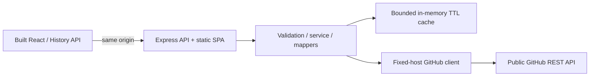

# OpenSource Explorer

Search public GitHub repositories, inspect a project, and discover a bounded sample of open contribution issues. Built as an AI-assisted software-engineering learning/portfolio project with React, TypeScript, Express and the official GitHub REST API.

**Current status (2026-10-19):** The five development phases are integrated into `main`, and the project owner reports a public Render deployment. The recorded Phase 5 tests and CI checks were performed before deployment; the live site's availability and performance have not been independently audited.

[Permanent phase progress](docs/PHASE_PROGRESS.md) · [Current status](docs/PROJECT_STATUS.md) · [Phase5 evidence](docs/PHASE_5_VERIFICATION.md) · [Deployment readiness](docs/DEPLOYMENT_READINESS.md)

## Live demo

**Website:** [https://opensource-explorer.onrender.com/](https://opensource-explorer.onrender.com/)

The application is hosted on a Render free web service. Following inactivity, the server may sleep and the first visit may take around a minute to wake up. The live URL and hosting status are owner-reported; automated public-host verification is not claimed here. If the service is temporarily unavailable, the project can be run locally using the instructions below.

**Source:** [GitHub repository](https://github.com/AliSherLeghari/opensource-explorer) · **Public API health:** [Health endpoint](https://opensource-explorer.onrender.com/api/health)

## Application

- Explicit repository search with language/sort/order/page size, runtime-validated cards, bounded pagination and truthful incomplete/truncated warnings.
- Shareable detail routes with refresh/back/forward, preserved in-memory search and distinct safe GitHub links.
- Up to10 open contribution entries labeled good first issue/help wanted, explicitly excluding PRs and stating that labels are not contribution guarantees.
- Loading/empty/errors, cancellation/stale-result guards, manual retry and rate-limit cooldown; no automatic GitHub polling.
- Compact accessible layout, keyboard focus/status, reduced motion and automated checks at360/390/768/1280.

The application itself needs no GitHub API token, app login, database, or paid API. A hosted service is optional for local operation; the public demo is deployed separately on Render's free offering. Public GitHub quotas still apply; cloud proxy authentication can inflate observed quotas independently of our token-free request code.

## Architecture



Development uses Vite5173 → Express3001. Production is one Node service: Express serves prebuilt React assets and `/api`. Only supported frontend routes receive SPA HTML; API/asset errors stay JSON404. CSP/security headers, read-only API/request limits, safe correlation logs, readiness and graceful shutdown protect the current surface. No microservices, DB, auth or permissive CORS was added.

| Path                                                               | Purpose                                                                                           |
| ------------------------------------------------------------------ | ------------------------------------------------------------------------------------------------- |
| `frontend/src/search/`                                             | Controlled search, typed/runtime API parsing, cards and cancellation                              |
| `frontend/src/details/`, `routing.tsx`                             | Detail/issues pages, resource lifecycle, History API routing                                      |
| `backend/src/repositories/`                                        | HTTP routes, validators, normalized contracts, service/cache, issue filtering                     |
| `backend/src/github/client.ts`                                     | Fixed GitHub origin/headers, timeouts and safe upstream errors                                    |
| `backend/src/app.ts`, `security.ts`, `runtime.ts`, `server.ts`     | HTTP/static composition, security/admission/logs, listener/shutdown, entry configuration          |
| `Dockerfile`, `compose*.yaml`, `.github/workflows/engineering.yml` | Multi-stage packaging, one-service runtime and hosted quality/Docker CI                           |
| `docs/`                                                            | Progress journal, per-phase evidence/lessons, architecture/API/security/operations/ADRs/readiness |

[Requirements and architecture](docs/ARCHITECTURE.md) · [API contract](docs/API.md) · [Decisions](docs/adr/0001-engineering-decisions.md) · [Security review](docs/SECURITY.md)

## Run and verify

Use Node24.x, npm and the committed lockfile. Cloud Node24.19.0/npm11.9.0 and the pinned official Node24 image (24.22.0 at the recorded digest) were verified.

```sh
npm ci --cache /tmp/opensource-npm-cache
npm run check
npm run test:coverage
npm run build
npm start
```

Root `npm start` selects production and serves UI/API on PORT3001; build first. Normal laptops can use their default npm cache. For development: `npm run dev`; in the managed cloud use `NODE_USE_ENV_PROXY=1 npm run dev` and preserve its proxy/CA settings. Cloud-first/local-hybrid tools are permitted; no laptop work has been falsely reported as executed.

| Command                                                   | Verification                                                                        |
| --------------------------------------------------------- | ----------------------------------------------------------------------------------- |
| `npm run check`                                           | Formatting, lint, strict workspace types,81 frontend/154 backend tests, both builds |
| `npm run test:coverage`                                   | V8 measured scope; thresholds90% lines/statements,85% branches/functions            |
| `npm run test:e2e`                                        | 13 development Chromium tests with controlled GitHub data                           |
| `npm run test:production`                                 | 5 built Express-served browser/CSP/deep-link/accessibility tests                    |
| `npm run audit`                                           | npm advisory scan, high/critical failure threshold                                  |
| `npm run security:check`                                  | Tracked artifact/common-secret-pattern checks; not universal secret detection       |
| `node scripts/smoke-production.mjs http://127.0.0.1:8080` | Bounded readiness wait + real HTML/assets/API/deep-link smoke                       |

If a host configures `NODE_ENV=production` during dependency installation, use `npm ci --include=dev` for the build: TypeScript, Vite, and type definitions are development dependencies. The production server is started with `npm start`. The project owner has also reported successful local Windows startup; this is distinct from the recorded Codex/CI checks.

This cloud worker uses `CHROMIUM_PATH=/usr/bin/chromium` before browser commands. A normal laptop/CI can install Playwright Chromium with `npx playwright install --with-deps chromium`. Never reinstall dependencies while tests are running. Commands and troubleshooting are detailed in [OPERATIONS](docs/OPERATIONS.md).

## Docker and CI evidence

```sh
docker info
docker compose build
docker compose up -d --wait --wait-timeout 60
node scripts/smoke-production.mjs http://127.0.0.1:8080
docker compose stop
docker compose down --remove-orphans
```

The multi-stage official Node24 image is deliberately digest-pinned. Builder tools remain outside the backend-only production dependency/runtime stage. It runs as UID1000; Compose uses read-only filesystem, dropped capabilities, no-new-privileges and resource bounds. Container health, custom PORT4000, UI/assets/API/deep-link checks, EROFS and normal SIGTERM exit0 were actually verified in Codex Cloud. The optional cloud overlay supplies proxy CA by secret/read-only mount without baking session configuration; see the runbook before running Docker here.

**Actual hosted run:** [Engineering39051249057](https://github.com/AliSherLeghari/opensource-explorer/actions/runs/39051249057) passed quality and Docker jobs on implementation `5ebaca4e448c72c93056973c0279ad9cc58d4ebb`. Public standard Ubuntu runners, SHA-pinned first-party actions, contents:read, concurrency cancellation; no paid runners, image push, artifact upload or deployment by that workflow. Raw hosted log download was policy-blocked; job/step conclusions were read from GitHub API, while detailed test/coverage numbers come from cloud execution. Check the final branch's latest CI separately after handoff commits.

Measured cloud coverage: frontend97.33% lines/94.25% branches; backend97.93% lines/95.97% branches. npm audit reported0 findings in cloud. These are scoped observations, not security/performance certification. No OS-image CVE scan, native screen-reader or host/load/TLS test is claimed. The readiness checklist preserves those gaps and the owner review/hosting-cost/Phase6 gates.

## API and configuration

- `GET /api/health`: liveness only; `GET /api/ready`: process/assets/draining readiness, no GitHub probe.
- `GET /api/repositories?q=react&language=TypeScript&sort=stars&order=desc&page=1&per_page=20`.
- `GET /api/repositories/:owner/:repo` and `.../issues?label=good-first-issue|help-wanted`.

`PORT` defaults3001; `GITHUB_TIMEOUT_MS` defaults5000 (100–30000) per upstream call. Root npm start forces NODE_ENV=production. `.env.example` documents settings without auto-loading or secrets. Frontend deadline is10s. Full contracts, error codes, request/cache/quota limits and readiness semantics are in [API](docs/API.md).

## Learn and review

[Lesson1 foundation](docs/learning/LESSON_01_FOUNDATION.md) · [Lesson2 GitHub backend](docs/learning/LESSON_02_GITHUB_API.md) · [Lesson3 React search](docs/learning/LESSON_03_REACT_SEARCH.md) · [Lesson4 details/issues](docs/learning/LESSON_04_REPOSITORY_DETAILS.md) · [Lesson5 production engineering](docs/learning/LESSON_05_PRODUCTION_ENGINEERING.md)

Reviewed production fixture screenshots: [360px search](docs/screenshots/phase-5-production-search-360.png), [768px details](docs/screenshots/phase-5-production-details-768.png), [1280px details](docs/screenshots/phase-5-production-details-1280.png). These show deterministic test data, not a live fixture repository. Actual-data live checks in earlier phases are recorded separately with proxy-auth caveats.

Every future implementation task must update the central progress file and its own verification report in the same commit(s). Keep claims truthful about AI assistance, independently authored work, test provenance, exact refs, current branch state, and deployment status. The historical Phase 1–5 stacked PR workflow is complete; new changes should use their own reviewable PRs.
