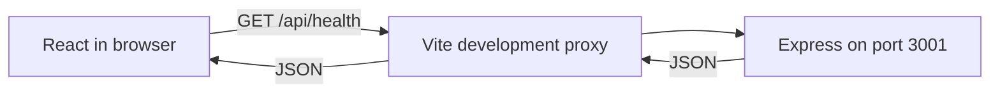

# OpenSource Explorer

A student full-stack learning project built with AI assistance and code review. The planned product helps people discover public GitHub repositories. **Phase 1 implements the foundation only: repository search is not implemented.**

## What works

- Responsive React homepage with navigation, labeled search/language preview controls, and explicit coming-soon messaging.
- Real backend connection check, response validation, five-second timeout, and retry.
- Express `GET /api/health`, structured 404/500 responses, and validated `PORT` configuration.
- npm workspaces, TypeScript, formatting, linting, unit/integration tests, and Chromium browser tests.

No database, authentication, GitHub token, paid API, hosted service, deployment, or GitHub Actions workflow is configured.

## Cloud development

All commands below are for Codex Cloud; students can ask Codex to run them from Android. No local terminal is required. Use Node.js 24.x and npm 11.x (verified: Node 24.19.0, npm 11.9.0).

```sh
cd /workspace/new-project-reactjs-nodejs
npm ci --cache /tmp/opensource-npm-cache
npm run dev
```

The writable cache path avoids the restricted home directory in this environment. The frontend listens on port 5173 and proxies `/api` requests to port 3001. These are internal development addresses, not a public deployment. Stop both processes with Ctrl+C in the managing cloud process. `concurrently -k` stops the sibling process when one exits.

`PORT=4000 npm run dev -w backend` changes the backend port. If using the frontend with a changed backend port, update the proxy target in `frontend/vite.config.ts` too. `backend/.env.example` documents the setting; it is not loaded automatically. Set `PORT` in the process environment. No secrets are needed.

## Commands

| Command                                            | Purpose                                                      |
| -------------------------------------------------- | ------------------------------------------------------------ |
| `npm run dev`                                      | Start frontend and backend watchers                          |
| `npm run check`                                    | Formatting, lint, type checks, 19 tests, and builds          |
| `npm run format`                                   | Format source and documentation                              |
| `npm run test:e2e`                                 | Run three full-stack browser tests; starts/stops dev servers |
| `CHROMIUM_PATH=/usr/bin/chromium npm run test:e2e` | Use this cloud environment's installed Chromium              |
| `npm run build`                                    | Emit frontend assets and backend JavaScript                  |
| `npm run start -w backend`                         | Run compiled backend after building                          |

Browser tests use Playwright. Without a system Chromium, its matching browser must be installed in the cloud environment before running tests. Tests cover 390px and 1280px widths, real health connectivity, failure/retry, keyboard focus, overflow, and axe accessibility checks. Automated checks do not replace manual assistive-technology testing or physical Android testing.

## Health contract

```http
GET /api/health
HTTP/1.1 200 OK
Content-Type: application/json
Cache-Control: no-store
```

```json
{ "status": "ok", "service": "opensource-explorer-api" }
```

Health indicates this Express process responds. It does not check GitHub availability or future dependencies. The UI checks on mount and manual retry, not continuously.

## Architecture and files

```text
frontend/
  src/                 React UI, health client, styles, component tests
  index.html           Accessible document entry
  vite.config.ts       React plugin, API proxy, test setup
  tsconfig.json
  package.json
backend/
  src/
    app.ts             Express factory and error middleware
    config.ts          Port validation
    server.ts          Listener and shutdown handling
    app.test.ts        API and configuration tests
  .env.example
  tsconfig.json
  tsconfig.build.json
  package.json
docs/
  learning/LESSON_01_FOUNDATION.md
  PHASE_1_VERIFICATION.md
tests/foundation.spec.ts
AGENTS.md
README.md
package.json
package-lock.json
playwright.config.ts
eslint.config.js
tsconfig.base.json
.prettierrc.json
.prettierignore
.gitignore
```

Learning materials live in `docs/learning/` rather than a duplicate root `learning/` folder.



Production builds are verified, but production routing and hosting are deferred. The Vite proxy is development-only; a future deployment needs same-origin `/api` routing or an explicitly configured API origin and restrictive CORS. The backend currently serves JSON only, not frontend assets.

## Quality, cost, and learning

See [Phase 1 verification](docs/PHASE_1_VERIFICATION.md) and [Lesson 1](docs/learning/LESSON_01_FOUNDATION.md). All selected libraries are free and open source. No external billable services were activated. Hosting terms and Actions eligibility must be verified before those later phases. Unauthenticated GitHub API integration and rate-limit handling are also later work.

Review each phase in a feature branch/PR. Merging requires the student's approval. Contributions and learning claims should accurately acknowledge AI-assisted implementation and distinguish reading, modifying, and independently writing code.
