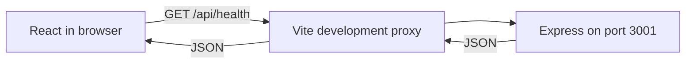

# OpenSource Explorer

A student full-stack learning project built with AI assistance and code review. The planned product helps people discover public GitHub repositories. **Phase 2 adds backend GitHub repository search and details. The Phase 1 homepage remains a preview; it is not wired to search yet.**

## What works

- Responsive React homepage with navigation, labeled search/language preview controls, and explicit coming-soon messaging.
- Real backend connection check, response validation, five-second timeout, and retry.
- Express `GET /api/health`, structured 404/500 responses, and validated `PORT` configuration.
- Validated backend search/details, normalized public repository data, safe upstream errors, request timeout, and bounded TTL cache.
- npm workspaces, TypeScript, formatting, linting, unit/integration tests, and Chromium browser tests.

No database, authentication, GitHub token, paid API, hosted service, deployment, or GitHub Actions workflow is configured.

## Cloud development

All commands below are for Codex Cloud; students can ask Codex to run them from Android. No local terminal is required. Use Node.js 24.x and npm 11.x (verified: Node 24.19.0, npm 11.9.0).

```sh
cd /workspace/new-project-reactjs-nodejs
npm ci --cache /tmp/opensource-npm-cache
NODE_USE_ENV_PROXY=1 npm run dev
```

The writable cache path avoids the restricted home directory in this environment. `NODE_USE_ENV_PROXY=1` enables Node 24 to use the cloud-provided HTTP(S) proxy for GitHub requests while preserving TLS verification. It is a cloud runtime setting, not a credential; no token is required by the app. The frontend listens on port 5173 and proxies `/api` requests to port 3001. These are internal development addresses, not a public deployment. Stop both processes with Ctrl+C in the managing cloud process. `concurrently -k` stops the sibling process when one exits.

`PORT=4000 npm run dev -w backend` changes the backend port. If using the frontend with a changed backend port, update the proxy target in `frontend/vite.config.ts` too. `backend/.env.example` documents the setting; it is not loaded automatically. Set `PORT` in the process environment. No secrets are needed.

## Commands

| Command                                            | Purpose                                                      |
| -------------------------------------------------- | ------------------------------------------------------------ |
| `npm run dev`                                      | Start frontend and backend watchers                          |
| `npm run check`                                    | Formatting, lint, type checks, 109 tests, and builds         |
| `npm run format`                                   | Format source and documentation                              |
| `npm run test:e2e`                                 | Run three full-stack browser tests; starts/stops dev servers |
| `CHROMIUM_PATH=/usr/bin/chromium npm run test:e2e` | Use this cloud environment's installed Chromium              |
| `npm run build`                                    | Emit frontend assets and backend JavaScript                  |
| `npm run start -w backend`                         | Run compiled backend after building                          |

Browser tests use Playwright. Without a system Chromium, its matching browser must be installed in the cloud environment before running tests. Tests cover 390px and 1280px widths, real health connectivity, failure/retry, keyboard focus, overflow, and axe accessibility checks. Automated checks do not replace manual assistive-technology testing or physical Android testing.

## Health contract

```http
GET /api/health
HTTP/1.1 200 OK
Content-Type: application/json
Cache-Control: no-store
```

```json
{ "status": "ok", "service": "opensource-explorer-api" }
```

Health indicates this Express process responds. It does not check GitHub availability or future dependencies. The UI checks on mount and manual retry, not continuously.

## Architecture and files

```text
frontend/
  src/                 React UI, health client, styles, component tests
  index.html           Accessible document entry
  vite.config.ts       React plugin, API proxy, test setup
  tsconfig.json
  package.json
backend/
  src/
    app.ts             Express factory and error middleware
    config.ts          Port validation
    server.ts          Listener and shutdown handling
    app.test.ts        Foundation API and configuration tests
    github/client.ts   GitHub HTTP client and safe upstream error mapping
    repositories/     Routes, validation, mapping, service, cache, errors, tests
  .env.example
  tsconfig.json
  tsconfig.build.json
  package.json
docs/
  learning/LESSON_01_FOUNDATION.md
  learning/LESSON_02_GITHUB_API.md
  PHASE_1_VERIFICATION.md
  PHASE_2_VERIFICATION.md
  PROJECT_STATUS.md
scripts/smoke-github.mjs
tests/foundation.spec.ts
AGENTS.md
README.md
package.json
package-lock.json
playwright.config.ts
eslint.config.js
tsconfig.base.json
.prettierrc.json
.prettierignore
.gitignore
```

Learning materials live in `docs/learning/` rather than a duplicate root `learning/` folder.



Production builds are verified, but production routing and hosting are deferred. The Vite proxy is development-only; a future deployment needs same-origin `/api` routing or an explicitly configured API origin and restrictive CORS. The backend currently serves JSON only, not frontend assets.

## Quality, cost, and learning

See [project status](docs/PROJECT_STATUS.md), [Phase 2 verification](docs/PHASE_2_VERIFICATION.md), and [Lesson 2](docs/learning/LESSON_02_GITHUB_API.md). [Phase 1 verification](docs/PHASE_1_VERIFICATION.md) and [Lesson 1](docs/learning/LESSON_01_FOUNDATION.md) remain historical foundation references. All selected libraries are free and open source. No external billable services were activated. Hosting terms and Actions eligibility must be verified before those later phases. The application sends no Authorization header. Live cloud responses may reflect platform proxy credentials; observed quotas must not be presented as the public unauthenticated allowance.

Review each phase in a feature branch/PR. Merging requires the student's approval. Contributions and learning claims should accurately acknowledge AI-assisted implementation and distinguish reading, modifying, and independently writing code.

## Phase 2 backend API

`GET /api/repositories?q=react&language=TypeScript&sort=stars&order=desc&page=1&per_page=20`

| Parameter  | Rules and defaults                                                                                                                                                             |
| ---------- | ------------------------------------------------------------------------------------------------------------------------------------------------------------------------------ |
| `q`        | Required, trimmed, whitespace collapsed; 1–200 characters. Control characters and qualifier colons are rejected; this is text search, not a full GitHub advanced-query editor. |
| `language` | Optional; 1–50 letters, digits, spaces, or `. + # -`; trimmed and lowercased. Empty values are invalid.                                                                        |
| `sort`     | `best-match` (default), `stars`, `forks`, or `updated`; best match omits GitHub's sort parameter.                                                                              |
| `order`    | `desc` (default) or `asc`; GitHub controls relevance ordering for best match.                                                                                                  |
| `page`     | Positive integer, default 1; cannot exceed `floor(1000 / effective_per_page)`.                                                                                                 |
| `per_page` | Positive safe integer, default 20, capped at 50; response reports the effective value.                                                                                         |

Unknown or repeated query parameters are rejected. Inputs never enter HTTP headers. The service appends `is:public` and the validated language qualifier, using `URL` and `URLSearchParams` for encoding.

Search returns `{ repositories: [...], pagination: {...} }`. Detail at `GET /api/repositories/:owner/:repo` returns `{ repository: {...} }`. Owners must match GitHub's alphanumeric/hyphen username shape (1–39 characters, no leading/trailing/consecutive hyphens). Repository names allow letters, digits, `.`, `_`, `-`, up to 100 characters; `.` and `..` are invalid. Detail lookup normalizes case. Malformed URL encoding is a 400.

Each repository has exactly `name`, `owner` (login string), `description`, `language`, `stars`, `forks`, `open_issues`, and `url`. Description/language may be null. GitHub's `open_issues_count` includes pull requests; this is not a promise of issue-only counts. Non-public or malformed upstream records are rejected. Browser-facing repository URLs must be HTTPS GitHub URLs matching the returned owner/name.

Pagination contains `page`, `per_page`, `total_count`, `accessible_pages`, `has_next_page`, `search_limit` (1000), `truncated`, and `incomplete_results`. GitHub's total is a snapshot, not a guarantee of retrievable/stable results. `accessible_pages` is bounded by both reported total and `floor(1000 / per_page)`; for 30 per page, only 33 full pages (990 slots) are addressable by this API. `truncated` says the reported total exceeds those slots. `has_next_page` also requires a full current page; it is guidance, not a guarantee. `incomplete_results` independently reports GitHub search incompleteness. A valid page beyond the actual result count may return an empty list.

### Failures and resource limits

| HTTP | Meaning                                                                     |
| ---- | --------------------------------------------------------------------------- |
| 400  | Invalid inputs or GitHub 422 rejection; simplify the query/check pagination |
| 404  | Public repository missing, or unknown application route                     |
| 429  | Primary/secondary rate limit; wait before retrying                          |
| 502  | Network failure, invalid GitHub JSON/data, or another upstream failure      |
| 503  | GitHub maintenance or non-rate-limit access restriction                     |
| 504  | GitHub timeout, including a slow response body                              |
| 500  | Unexpected internal application error                                       |

Errors use `{ error: { code, message, retry_after_seconds?, rate_limit_reset? } }`. Known rate limits return a numeric `Retry-After` header, falling back to 60 seconds if unavailable; guidance is bounded to 1–86400 seconds. A valid reset value is a Unix timestamp in seconds. Maintenance retry guidance is forwarded when available. Original upstream messages/headers are not blindly echoed. The application makes no automatic retries or polling requests.

`GITHUB_TIMEOUT_MS` defaults to 5000 and accepts integers 100–30000. Set it in the process environment; `.env.example` documents it but is not automatically loaded. The API version is pinned to `2022-11-28` with fixed Accept/User-Agent headers. Redirects fail closed instead of forwarding requests to other destinations.

The process-local cache stores only successful, fully validated results for 60 seconds, up to 100 entries shared across search/detail. Keys are normalized complete API URLs. Reads do not refresh expiry; oldest inserted entries are evicted at capacity and expired entries are pruned on reads/writes. It resets on restart and is not shared between processes. Empty search results can be cached; errors cannot. Simultaneous misses are not coalesced, and there is no distributed quota coordination. Responses use `Cache-Control: no-store`; the internal cache is separate from browser caching.

The public unauthenticated API generally permits 60 requests/hour/IP, with a separate tighter search quota. Shared cloud IPs and secondary limits can reduce availability. No paid quota upgrade, PAT, OAuth, database, or hosting was added. See the official [GitHub rate-limit documentation](https://docs.github.com/en/rest/using-the-rest-api/rate-limits-for-the-rest-api); actual headers govern observed availability.

For an optional **manual** cloud smoke test after building:

```sh
NODE_USE_ENV_PROXY=1 node scripts/smoke-github.mjs
```

This makes at most two GitHub requests, checks live search/details, and verifies a cached repeat. It is not part of ordinary automated tests. Tests remain fully mocked when GitHub is unreachable. A proxy 403 before HTTP reaches GitHub is an environment-access problem: from Android Chrome, review environment network settings for `api.github.com` and save/publish changes as required. Do not paste credentials into chat or disable TLS. In the current task GitHub API calls succeeded, although the environment policy metadata still reported unknown enforcement.

Phase 2 is stacked on the unmerged `feat/phase-1-foundation` branch (PR #1). Review its PR against that branch to see only Phase 2 changes. After Phase 1 is approved/merged, retarget Phase 2 to `main` and verify the resulting diff before any separate merge approval.
