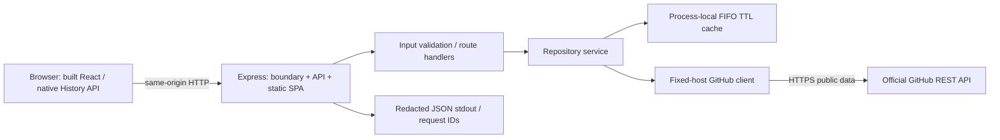

# Architecture and requirements

## Purpose and acceptance criteria

OpenSource Explorer helps a visitor search public GitHub repositories, inspect a repository, and find a bounded sample of open contribution issues. No account, database, paid API, or service is required. Maintainer labels are suggestions, not guarantees of difficulty or acceptance.

| Requirement                                           | Implementation and acceptance evidence                                                                                                                  |
| ----------------------------------------------------- | ------------------------------------------------------------------------------------------------------------------------------------------------------- |
| Search public repositories with filters/page controls | `SearchExplorer`, `useRepositorySearch`, `/api/repositories`; controlled input/validation and existing component/browser tests                          |
| Share/refresh repository details and navigate back    | `routing.tsx`, `RepositoryDetails`, same-origin production SPA routes; direct refresh/browser history tests                                             |
| Discover contribution issues safely                   | `validateIssueFilter`, `issues`, `mapIssueList`; two labels, ten-entry upstream window, PR exclusion, public metadata check, safe URL and failure tests |
| Respect API limits and data contracts                 | Fixed-host GitHub client, timeout/rate error mapping, 100-entry/60s success cache, bounded ingress limiter; unit/integration tests                      |
| One deployable frontend/backend release               | Multi-stage Dockerfile builds both; Express serves built assets plus API; production browser/HTTP/container checks                                      |
| Operational safety                                    | Liveness/readiness distinction, redacted correlation logs, timeouts, graceful/forced shutdown, non-root/read-only container; runtime/security tests     |
| Accessible restrained UI                              | Native controls, focus/title/status, reduced motion, no overflow at 360/390/768/1280, axe checks; physical assistive testing remains separate           |
| Zero-cost and review discipline                       | Public standard hosted CI only; no paid scanner/registry/deploy; stacked branches unmerged; progress and readiness documents                            |

Out of scope: authentication, persistence/bookmarks, global issue search, distributed caches, microservices, telemetry vendors, deployment and Phase 6 authorization.

## Components



Development uses Vite on 5173 proxying `/api` to Express 3001. Production uses Express alone, with `frontend/dist` and `backend/dist` built together. No browser-direct GitHub calls or permissive CORS are needed. Only `/` and syntactically valid `/repositories/:owner/:repo` routes receive HTML; missing API/assets/unknown paths remain JSON 404s. Static dotfiles are ignored. HTML is revalidated; hashed Vite assets receive immutable cache headers.

## Module direction and data flow

Frontend components → frontend API parser/transport → Express routes → validation/service → upstream client/cache/mappers. Mappers validate external JSON; TypeScript alone cannot validate responses. The UI renders text and verified GitHub links, never issue Markdown/HTML.

```mermaid
sequenceDiagram
  participant U as Browser
  participant B as Express boundary
  participant V as Validator/service
  participant C as Cache
  participant G as GitHub
  U->>B: GET /api/repositories/:owner/:repo/issues?label=...
  B->>B: New request ID; headers; URL/body/method/admission limits
  B->>V: Allowlisted label and normalized owner/repo
  V->>C: Public metadata lookup, then issue URL lookup
  opt Public metadata cache miss
    V->>G: Fixed /repos/:owner/:repo
    G-->>V: Validate private=false and repository contract
  end
  opt Issue cache miss
    V->>G: Fixed open/label/page1/per_page10 issue list
    G-->>V: External JSON
    V->>V: Reject unsafe data; exclude PR/nonmatching entries
    V->>C: Store success only, at most 60 seconds
  end
  V-->>U: Small issue contract or structured safe error
  B->>B: Log only ID, method, web/API surface, status, duration
```

`app.ts` composes HTTP behavior without opening a port. `runtime.ts` owns listener/timeouts/readiness/shutdown. `server.ts` reads validated settings, resolves built assets relative to its module, and registers signals. `scripts/start-production.mjs` makes `npm start` unambiguously production across platforms; dev uses `tsx watch` and no static build requirement.

## Operational contracts

- `/api/health`: liveness, 200 `{status:"ok", service:"opensource-explorer-api"}` when the process can respond. No GitHub probe.
- `/api/ready`: 200 `ready` only while accepting service and built index exists; 503 `not_ready` while draining/missing assets. Does not claim GitHub quota/availability.
- `PORT`: default 3001, integer 1–65535. `NODE_ENV=production` selects built serving in the raw backend entry; root `npm start` always sets it. `GITHUB_TIMEOUT_MS`: 5000 default, 100–30000 per upstream call.
- Inbound headers deadline 10s, request deadline 15s, socket inactivity timeout 20s, keepalive 5s, maximum 50 parsed header fields. Node scheduling/parser behavior is not a hostile-traffic benchmark.
- API supports GET/HEAD only, no request body; body length over 16KiB gets 413, API bodies otherwise 400, methods 405, URLs over 4096 characters 414. No JSON body parser/storage is needed.
- Ingress limiter: 120 API reads/minute/client IP, bounded to 1000 active clients, expiry 60s. Health/readiness exempt. New identities at capacity get 503; exhausted identities 429 with Retry-After. Proxy trust disabled so arbitrary X-Forwarded-For cannot bypass it.
- Cache: 100 entries shared among search/details/issues, TTL60s, FIFO, success-only, process-local, no concurrent-miss coalescing. API responses no-store; internal Map is separate.
- SIGINT/SIGTERM: mark not ready, close listener/idle connections, finish active requests, ten-second forced-close/exit1 deadline; Compose grants twelve seconds. Normal verified stop exits0. In-flight external work can finish/abort on its own deadline; forced exit is the upper bound.

## Limits and design rationale

The limiter is admission hygiene, not a distributed quota budget or DDoS service. Direct IP identity behind an untrusted proxy can aggregate clients; Phase 6 must establish the exact proxy chain before changing trust. Public GitHub's general anonymous allowance is normally 60/hour/IP plus separate search/secondary limits. No public uptime/capacity guarantee is made. The cloud proxy can inject authentication; observed larger quotas are not proof of anonymous access.

We do not add DB/auth/Redis to solve requirements that are absent. Tests use mocks for upstream failures/quota boundaries. Runtime packaging removes dev dependencies, test sources, docs, CA/session files, and Git history; Docker's optional cloud CA mount exists only during network steps or as a runtime read-only mount. See [ADRs](adr/0001-engineering-decisions.md), [security](SECURITY.md), [operations](OPERATIONS.md), and [readiness](DEPLOYMENT_READINESS.md).
