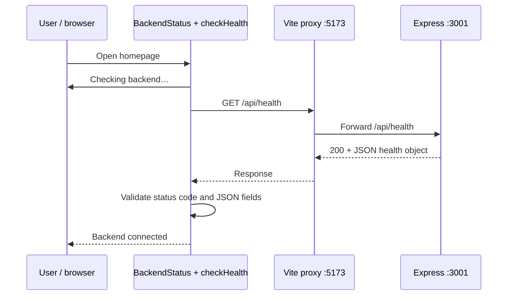

# Lesson 01: A working full-stack foundation

## 1. What we built and why

OpenSource Explorer now has a React homepage and an Express API. The page proves communication by calling a real health endpoint. Search controls are a preview only: typing and selecting values does not call GitHub. Building this small connection first separates setup mistakes from the more complex GitHub integration in Phase 2.

A **frontend** runs in the browser and presents controls and feedback. A **backend** runs on a server and handles HTTP requests. **Full-stack development** connects both. In our cloud workspace they are separate processes; the browser receives frontend JavaScript and requests API data.

## 2. JavaScript and TypeScript in this project

JavaScript runs the application. TypeScript adds checks before execution; its types are removed during compilation.

In `frontend/src/BackendStatus.tsx`:

```ts
type Connection = 'loading' | 'connected' | 'error';
```

This union restricts connection state to three strings. A typo such as `'conected'` fails type checking. `const` prevents rebinding a variable; it does not make an object immutable. `let active = true` can change during cleanup.

Functions package behavior. `parsePort(value: string | undefined): number` accepts text or an absent value and returns a number. `undefined` means no environment setting was provided. `Number(value)` converts validated digits into a numeric port. Regex `/^\d+$/` requires the whole string to contain only digits, so `3001junk` is rejected instead of silently becoming 3001.

`async` functions return promises, representing work completed later. In `health.ts`, `await fetch(...)` waits for the HTTP response and `await response.json()` waits for parsing. Rejected promises reach `.catch(...)`. `.finally(...)` clears the timer whether the request succeeds or fails.

TypeScript cannot prove external JSON is safe. `const body: unknown` deliberately requires runtime checks before trusting `body.status` or `body.service`.

## 3. React components and the document

`frontend/index.html` supplies the language, title, viewport metadata, and `<div id="root">`. `src/main.tsx` uses `createRoot` to mount `<App />` inside that root. The non-null assertion `!` tells TypeScript the root exists because we control the HTML; it would not protect us if we removed that element.

`App()` returns JSX: HTML-like syntax compiled into JavaScript. It describes the header, main sections, labeled controls, and footer. `className` supplies a CSS class. Components begin with capital letters: `<BackendStatus />` calls a reusable React component rather than creating a custom HTML tag.

`BackendStatus()` owns the only application state:

- `connection` controls loading, success, or error text.
- `attempt` increments when Retry is clicked and triggers another effect.

The preview input and select are **uncontrolled**: the browser stores their current values. We do not need React state until search behavior exists. The Search button is disabled and the page explains why.

`useEffect` runs the health request after rendering. Its dependency array `[attempt]` means it reruns when the retry count changes. Cleanup aborts the old request, clears the timer, and marks the effect inactive so an old result cannot update the current UI. React StrictMode intentionally repeats effect setup/cleanup in development to expose lifecycle mistakes; cancellation makes this safe.

The five-second timeout uses `AbortController`. The component catches cancellation from the timeout and shows an error; cancellation during unmount does not update a removed component. This check runs on mount and retry, not periodically.

## 4. Node.js, Express, HTTP, and JSON

Node.js executes JavaScript outside the browser. It provides server capabilities and `process.env`, which the browser does not provide in the same way. Express is a library on top of Node's HTTP facilities; it matches routes and constructs responses.

`backend/src/app.ts` contains:

```ts
app.get('/api/health', (_req, res) => {
  res.set('Cache-Control', 'no-store').json({
    status: 'ok',
    service: 'opensource-explorer-api',
  });
});
```

- `GET` is the HTTP method for reading information.
- `/api/health` is the path.
- `_req` is the unused request; `res` builds the response.
- `.json(...)` serializes a JavaScript object to JSON and sets its content type.
- The default status is `200`, meaning success.
- `no-store` tells caches not to retain the result.

JSON is a text interchange format. It uses quoted property names, such as `{"status":"ok"}`, and cannot carry JavaScript functions. An HTTP response has a status code, headers, and usually a body; JSON is only the body format.

`createApp()` constructs and returns the Express app without opening a port. `server.ts` calls `createApp().listen(port)` to start listening. This separation lets Supertest exercise the API without importing a long-running production server.

`parsePort()` defaults to 3001, accepts valid ports from 1 through 65535, and rejects malformed values. `server.ts` reports startup failures and handles SIGINT/SIGTERM by closing the listener. There is no forced shutdown deadline yet; future long-lived requests may require one.

## 5. Follow one request through the stack



`checkHealth(signal)` uses a relative URL, `/api/health`. The browser sends it to the same origin as the page. `frontend/vite.config.ts` forwards that path to `http://127.0.0.1:3001`. This avoids adding broad CORS permissions during development.

**Important:** Vite's development proxy is not included in built JavaScript. Production hosting must provide API routing or a deliberate cross-origin configuration. Building successfully does not equal deploying successfully.

## 6. Errors and security

`fetch` does not reject just because a server returns 404 or 500, so `checkHealth()` explicitly checks `response.ok`. It also checks the JSON body: a successful HTML response, invalid JSON, or an unrelated service must not display a false success.

Unknown backend paths return a structured 404. `errorHandler` uses Express's four-argument error middleware signature and returns a generic 500 response while logging details on the server. Tests use a temporary throwing route to exercise it; there is no diagnostic failure route in the real app. Disabling `x-powered-by` reduces unnecessary framework disclosure, but is not comprehensive security hardening.

We have no user accounts, tokens, database, or GitHub calls. Health should stay free of secrets. `.gitignore` excludes environment files, dependencies, build outputs, and browser artifacts. `.env.example` is documentation only: Node does not automatically load it in our scripts. Do not put credentials in frontend environment variables; browser assets are public.

Accessibility decisions include real labels, semantic landmarks, a skip link, visible keyboard focus, text alongside colored status dots, and `role="status"` for polite live updates. CSS grid stacks the search controls below 760px. Automated axe scans cannot establish complete accessibility or physical-device compatibility.

## 7. npm workspaces, dependencies, and configuration

The root `package.json` declares `frontend` and `backend` as workspaces. One `npm ci` installs both from `package-lock.json`. The lockfile records resolved versions and integrity hashes for repeatable installs. `npm install` intentionally changes dependency declarations/lockfile; `npm ci` checks agreement and installs the locked dependency tree.

Runtime dependencies include React/React DOM and Express. Development dependencies include TypeScript, Vite, tsx, test tools, ESLint, and Prettier. Free open-source packages do not themselves require a paid service account.

`npm run dev` uses `concurrently` to start two commands. The frontend uses Vite; the backend uses `tsx watch` to execute TypeScript and restart after edits. `npm run build` emits frontend assets in `frontend/dist/` and backend JavaScript in `backend/dist/`. `npm run start -w backend` runs that JavaScript with Node.

`tsconfig.base.json` shares strict checking and ES2022 targeting. Frontend configuration includes DOM types, JSX transformation, and bundler module resolution. Backend configuration uses `NodeNext` for Node's ES modules. Backend imports have `.js` extensions because emitted Node JavaScript needs them, even though the source files are `.ts`. `tsconfig.build.json` excludes test files from production output.

ESLint checks likely mistakes and hook usage; Prettier checks layout; TypeScript checks types. These tools answer different questions and none replaces behavioral tests. Root configuration files and browser test files are linted; the workspace type-check scripts check frontend and backend TypeScript, not the root Playwright configuration.

## 8. Tests tied to behavior

| File                        | What it verifies                                                                                                            |
| --------------------------- | --------------------------------------------------------------------------------------------------------------------------- |
| `backend/src/app.test.ts`   | Health JSON/headers, 404, generic 500, valid/default/invalid ports: 11 tests                                                |
| `frontend/src/App.test.tsx` | Accessible control labels, loading/success, error/retry, timeout, unmount abort, invalid health responses: 8 tests          |
| `tests/foundation.spec.ts`  | Real browser-to-backend connection at mobile/desktop widths, overflow, axe scans, keyboard focus, HTTP error/retry: 3 tests |

Vitest runs JavaScript/TypeScript tests. Supertest makes HTTP requests against an Express app. React Testing Library inspects the rendered UI by roles and labels. jsdom simulates the DOM but does not perform real browser layout. Playwright drives Chromium, and axe checks common accessibility rules.

Example backend assertion:

```ts
expect(response.body).toEqual({
  status: 'ok',
  service: 'opensource-explorer-api',
});
```

This catches a changed service name or missing status field. The browser tests additionally catch broken Vite proxy configuration that mocked frontend tests cannot detect. The error/retry browser test intercepts the first health requests with a 503, then removes interception and checks recovery against the real backend.

See `docs/PHASE_1_VERIFICATION.md` for actual run results. No test checks GitHub search because search does not exist yet.

## 9. Decisions and alternatives

- **Separate workspaces:** clear browser/server boundary, shared installation. Two independent repositories would add coordination overhead.
- **Small components:** App owns the page; BackendStatus owns connectivity; checkHealth owns the network contract. A global state library or custom generic fetch framework would be unnecessary here.
- **No shared types package yet:** runtime validation protects the small HTTP boundary. Larger contracts may justify shared schemas later.
- **No database/auth:** the planned public-repository explorer does not need them initially.
- **No external fonts/assets:** the page uses system fonts and CSS; no third-party asset service is required.
- **No automatic merge, CI, or deployment yet:** Phase 1 verifies the cloud development workflow. Later services need explicit cost/eligibility checks.

## 10. Interview questions

1. **What makes this full-stack?** A browser UI requests data from our own server through HTTP.
2. **Why separate app.ts and server.ts?** Tests can create the app without starting the production listener.
3. **Does TypeScript validate JSON?** No. Types disappear at runtime; external data needs runtime validation.
4. **Why check response.ok?** Fetch normally resolves even when HTTP status represents failure.
5. **Why use effect cleanup?** To cancel obsolete work and prevent stale results after unmount or retry.
6. **What does the Vite proxy do?** It forwards development `/api` requests to Express while preserving same-origin browser requests.
7. **What is an npm workspace?** A package managed together with other packages by a root npm project and lockfile.
8. **Unit vs integration vs browser tests?** Units check small functions; integrations check collaborating parts such as routes; browser tests exercise the running UI and server together.
9. **Does a health success prove GitHub is available?** No. This health endpoint checks only our API process.
10. **Why not add a database now?** The foundation has no persistence requirement; adding one increases complexity without user value.

## 11. Practical exercises from Android

Ask Codex to make one small change in a separate branch, then review the diff in GitHub Mobile or Android Chrome:

1. Explain `checkHealth` line by line, then propose a test for a response with the correct service but `status: 'down'`.
2. Change the homepage explanation and inspect the 390px screenshot for wrapping.
3. Add tests for port 1 and port 65535; explain why port 0 is rejected by this application's policy.
4. Ask Codex to temporarily break the Vite proxy, run the browser test, explain the failure, and restore it.
5. Trace how clicking Retry changes `attempt`, reruns the effect, and updates `connection`.
6. Review the generic 500 response and explain why returning a stack trace would expose implementation details.

Before Phase 2, be able to explain the request diagram, asynchronous state transitions, the difference between compile-time and runtime checks, and why mocked tests alone cannot verify connectivity. This implementation was AI-assisted; reading, explaining, testing, and changing it are distinct learning achievements.
