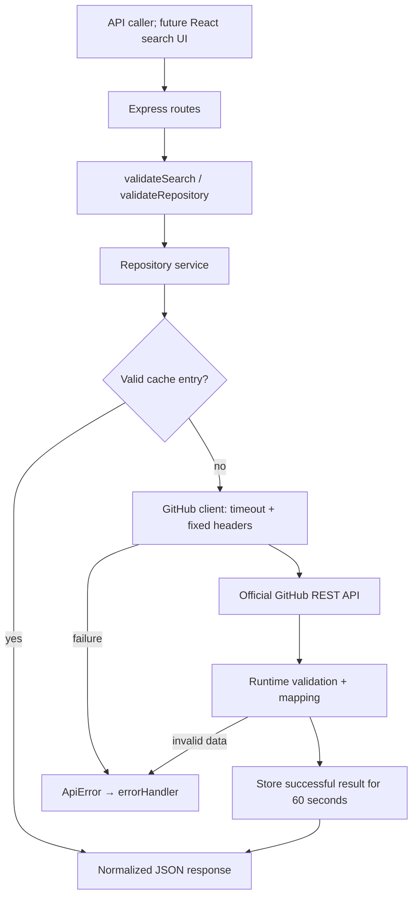

# Lesson 02: A safe GitHub API backend

## What changed, and what did not

Phase 2 implements GitHub Issue #2. Our server can now search public repositories and return one repository's details. The frontend is still the Phase 1 preview: typing into its search box does not call these new endpoints. Phase 3 will connect that experience only after authorization.

The changes use Node's built-in `fetch`, `URL`, `URLSearchParams`, `AbortController`, and `Map`. No new packages, database, token, paid service, or deployment were added. Phase 2 is a separate branch stacked on the unmerged Phase 1 PR.

## 1. Components and actual source files

| File / function                                                                                          | Responsibility                                                                         |
| -------------------------------------------------------------------------------------------------------- | -------------------------------------------------------------------------------------- |
| `backend/src/app.ts`: `createApp`, `errorHandler`                                                        | Mount routes; convert expected API errors into HTTP JSON; retain generic 500 handling  |
| `backend/src/repositories/routes.ts`: `createRepositoryRouter`                                           | Receive Express requests, validate inputs, call the service, send JSON                 |
| `backend/src/repositories/validation.ts`: `validateSearch`, `validateRepository`                         | Convert untrusted request values into controlled inputs                                |
| `backend/src/repositories/service.ts`: `createRepositoryService`, returned `search` and `detail` methods | Construct GitHub URLs, consult cache, normalize results, calculate pagination          |
| `backend/src/github/client.ts`: `createGithubClient`, returned `get` method                              | Make fixed-host HTTP requests, enforce deadlines, classify upstream failures           |
| `backend/src/repositories/mapping.ts`: `record`, `count`, `mapRepository`                                | Check unknown JSON at runtime and expose only our public response shape                |
| `backend/src/repositories/cache.ts`: `TtlCache.get`, `TtlCache.set`                                      | Keep successful results briefly with a maximum entry count                             |
| `backend/src/repositories/errors.ts`: `ApiError`, `invalidInput`, `invalidUpstream`                      | Represent deliberate public failures without leaking diagnostics                       |
| `backend/src/config.ts`: `parseGithubTimeout`                                                            | Validate the `GITHUB_TIMEOUT_MS` process setting                                       |
| `backend/src/server.ts`                                                                                  | Construct the configured client/service and open the server port                       |
| `backend/src/repositories/repositories.test.ts`                                                          | Mocked route, client, mapping, configuration, and cache behavior tests                 |
| `scripts/smoke-github.mjs`                                                                               | Optional live smoke check, with safe rate-header observations and no automatic retries |

The separation follows responsibilities, not a large framework. A route should not need to know cache eviction rules, and the HTTP client should not decide frontend field names.

## 2. API fundamentals: two different API boundaries

An API is a contract for communication. Our application exposes its own API and acts as a client of GitHub's API. The browser will eventually call **our** backend; it does not need GitHub credentials or knowledge of GitHub's response fields.



The Phase 1 browser still calls only `/api/health`. The diagram's search caller is currently a test or a direct API request, not an implemented React search action.

Example request:

```http
GET /api/repositories?q=react&language=TypeScript&sort=stars&page=1&per_page=20
```

The response has `repositories` and `pagination`. A detail request uses:

```http
GET /api/repositories/octocat/Hello-World
```

It returns `{ "repository": { ... } }`. Each repository has only `name`, `owner`, `description`, `language`, `stars`, `forks`, `open_issues`, and `url`. Nullable fields remain `null`, not misleading empty placeholders. `open_issues` comes from GitHub's `open_issues_count`, which includes pull requests.

## 3. Validation is a boundary, not just a nicer error message

Query strings and path parameters are untrusted. A query can contain duplicate keys, arrays, huge numbers, control characters, or unexpected names. TypeScript cannot prevent a remote caller from sending these values.

`validateSearch()`:

1. Rejects unknown or repeated parameters.
2. Trims strings and collapses whitespace, rejecting Unicode control characters first.
3. Requires `q` to have 1–200 characters without qualifier colons. Advanced GitHub qualifier syntax is intentionally outside this MVP.
4. Validates and lowercases `language` (optional, 1–50 letters/digits/spaces or `. + # -`).
5. Accepts `sort` only as `best-match`, `stars`, `forks`, or `updated` and `order` as `asc` or `desc`.
6. Parses positive safe integer pagination, defaults to page 1 and 20 items, caps page size at 50, and rejects pages outside the accessible search window.

For example, `per_page=100` becomes 50, while `per_page=0`, `page=1.5`, and duplicate `q` values produce HTTP 400. Silently truncating a query would change its meaning, so overlong queries are rejected rather than cut off.

`validateRepository()` permits only GitHub-style owner/repository names and lowercases the lookup key. Encoded slashes and invalid URL escapes cannot become arbitrary upstream paths. The app handles invalid URL decoding as 400.

## 4. Constructing URLs without mixing data and structure

The service uses `URL` and `URLSearchParams`. This matters when a query contains characters such as `&` or a language is `C++`.

A query value of `hello world & tools` remains one `q` value; it cannot introduce another HTTP query parameter. A validated language becomes `language:"c++"`. The service also appends `is:public`.

The central construction is:

```ts
const url = new URL('https://api.github.com/search/repositories');
```

The full parameter object is in `createRepositoryService().search()`. For best match, it omits GitHub's `sort` parameter; GitHub's relevance ordering controls the results. Details use encoded owner/repo segments and the fixed `https://api.github.com` origin.

Encoding protects URL structure; it does not validate the meaning of a search. GitHub may still reject unsupported searches with 422, which our API translates to a safe 400 asking the caller to simplify the query.

## 5. Async/await, fetch, and timeout

`createGithubClient().get()` is asynchronous. `await fetch(url, options)` waits for HTTP response headers; `await response.json()` also waits while the body is received and parsed. Waiting does not block Node from servicing other ordinary asynchronous requests.

The client sets only fixed headers:

```ts
headers: {
  'User-Agent': 'OpenSource-Explorer',
  Accept: 'application/vnd.github+json',
  'X-GitHub-Api-Version': '2022-11-28',
}
```

There is no Authorization header or user-controlled header value. Redirects use `redirect: 'error'`; a renamed/transferred repository redirect therefore currently becomes a safe upstream failure rather than being followed. This is a conservative tradeoff, not full redirect support.

The timeout pattern is:

```ts
const controller = new AbortController();
const timer = setTimeout(() => controller.abort(), timeoutMs);
```

The controller's signal is passed into fetch. The timer remains active through body parsing and is always cleared in `finally`. The default is 5000 ms. `GITHUB_TIMEOUT_MS` accepts 100–30000 ms; invalid settings fail startup instead of creating unpredictable behavior. Tests cover both a stalled fetch and a body that never finishes.

No automatic retry occurs. A failing request should not multiply upstream traffic or exhaust a shared quota.

## 6. Runtime contracts and data mapping

`response.json()` produces untrusted data. Our client returns `unknown`, forcing the service to validate it. `record()` requires an object; `count()` requires a nonnegative safe integer. `mapRepository()` requires a public repository and checks required fields, nullable strings, and the repository URL.

The mapper deliberately translates:

```text
GitHub stargazers_count → our stars
GitHub forks_count      → our forks
GitHub owner.login      → our owner
GitHub html_url         → our url
```

Only HTTPS `github.com` repository URLs matching the returned owner/name are accepted. Extra fields are discarded, including fields not relevant to our UI. An invalid upstream record causes 502 instead of quietly passing inconsistent data to the frontend or cache.

This is useful even with TypeScript because external JSON is not type-checked by our compiler. Future React components must still render repository descriptions as text, not raw HTML.

## 7. Pagination must describe what can actually be accessed

GitHub search exposes at most the first 1000-result window. A reported total of 50,000 does not mean our API can fetch 2500 pages of 20 results.

The service calculates:

```ts
const accessiblePages = Math.min(
  Math.ceil(total / input.perPage),
  Math.floor(1000 / input.perPage),
);
```

At 20 results/page, the maximum is 50 pages. At 30 results/page, our conservative maximum is 33 pages (990 slots), because page 34 would cross the search window. We do not pretend those last ten slots are addressable with this page size.

`total_count` preserves GitHub's reported total. `accessible_pages` is a bounded estimate. `truncated` marks totals larger than the accessible slots; `incomplete_results` independently preserves GitHub's warning that search was not complete. `has_next_page` requires both another accessible page and a full current page. It remains guidance: totals and rankings can change between requests, particularly when results are incomplete.

No results is a successful response: an empty array, zero accessible pages, and no next page. It is not the same as a missing repository detail (404).

## 8. Rate limits and safe error mapping

A rate limit restricts request frequency; it is not a paid subscription requirement. Public unauthenticated GitHub requests generally have a 60/hour/IP allowance, and search uses a separate tighter quota. Shared IPs and secondary limits matter. We do not buy extra capacity or ask for a PAT.

`ApiError` stores a deliberate HTTP status, stable code, safe message, and optional numeric retry information. `errorHandler()` turns it into JSON. Unexpected internal failures still receive the Phase 1 generic 500.

| Situation                                                            | Our response |
| -------------------------------------------------------------------- | ------------ |
| Invalid local input / upstream search rejection                      | 400          |
| Public repository not found                                          | 404          |
| 429, exhausted primary quota, or identified secondary limit          | 429          |
| Network failure, malformed upstream JSON/data, other upstream errors | 502          |
| Non-rate-limit 403 or GitHub 503                                     | 503          |
| Deadline exceeded                                                    | 504          |
| Unexpected internal programming failure                              | 500          |

A 403 is not automatically a rate limit. The client checks exhausted quota headers, Retry-After, or a rate-limit indication in the error body's message. The original body is never returned. This keeps access restrictions distinguishable from known rate limits.

`rateGuidance()` accepts numeric Retry-After or an HTTP date, falls back to a valid reset timestamp or 60 seconds, and bounds retry guidance to 1–86400 seconds. Numeric reset metadata uses Unix seconds. These are safe hints, not a guarantee that retrying then will succeed; if blocked again, wait rather than polling. Maintenance Retry-After is sanitized too.

In this cloud, live requests without an application Authorization header reported a 15,000 core allowance and a 30 search allowance. That is not proof of truly anonymous GitHub access: the platform proxy may inject authentication. The app remains token-free, but the report explicitly separates code behavior from outbound infrastructure behavior.

## 9. Caching: fewer repeated requests, bounded memory

A cache temporarily remembers an earlier answer. `TtlCache` uses a JavaScript `Map`, with 60-second TTL and a maximum of 100 entries shared by search/details.

The service's private `cached()` helper:

1. Uses the normalized complete GitHub URL as the key.
2. Returns a still-valid cached value when present.
3. Otherwise calls GitHub and validates/maps the result.
4. Stores only the completed successful result.

Different query text, languages, sort/order, page numbers, and page sizes create different keys. Normalized whitespace/language case and detail lookup case can share an entry. Empty search results are valid successes; errors, invalid JSON, and malformed data are not cached.

Reads do not extend TTL. Writes prune expired entries and evict the oldest inserted entry at capacity: FIFO, not least-recently-used. The cache resets on process restart. It is not shared across servers and does not combine simultaneous misses into one request. Those are deliberate limits of a small MVP, not guarantees of quota protection under load.

Browser responses use `Cache-Control: no-store`. This does not disable our explicit server-side Map; browser caching and server caching are different layers.

## 10. Testing and evidence

`repositories.test.ts` contributes 90 tests. Combined with Phase 1, the backend suite has 101 tests. The unchanged frontend suite has 8, and the existing Chromium suite has 3.

Mocked tests inject a `fetch` function into `createGithubClient()`. They build real Express routes and call them with Supertest, so routing, query parsing, validation, service behavior, mapping, and error responses cooperate as they do in the app. Tests assert the exact normalized JSON and outbound headers, not just HTTP 200.

Cases include valid search/detail, empty results, pagination/truncation, invalid/repeated inputs, malformed paths, rate limits, maintenance, timeout before headers and during body parsing, invalid JSON/data/URLs, public-only mapping, cache TTL/eviction, safe keys, and failure non-caching. The tests never need GitHub credentials or Internet access.

The optional smoke script uses built backend modules, opens a temporary local listener, requests health/search/details, repeats a detail lookup, and asserts only two upstream requests occurred. It logs only selected safe fields and rate headers, then closes the server. It is manual so routine test runs do not spend GitHub quota.

Read `docs/PHASE_2_VERIFICATION.md` for actual commands, results, and limits. Passing a mock test proves controlled behavior, not live connectivity. Passing a live request proves one observed interaction, not indefinite API availability.

## 11. Engineering decisions and alternatives

- **Native fetch instead of a GitHub SDK:** sufficient for two endpoints; fewer dependencies. A larger integration might justify an SDK.
- **Injected client/fetch/clock:** makes failure and expiry tests deterministic without a dependency-injection framework.
- **Runtime checks instead of a schema library:** the current response shape is small. A schema library could help if contracts grow.
- **Fixed host and no redirects:** reduces destination ambiguity. Supporting repository moves would need explicit trusted-host redirect logic.
- **Small FIFO cache instead of Redis/database:** avoids service accounts, infrastructure cost, and operational complexity.
- **Strict query interface instead of all GitHub advanced search:** easier to document and validate. Add capabilities only when a user story needs them.
- **No automatic retry:** respects limited/shared quotas; the caller receives retry guidance.
- **Stacked PR:** lets Phase 2 be reviewed without merging Phase 1 prematurely. After Phase 1 is approved and merged, retarget and verify the Phase 2 diff.

## 12. Interview questions

1. **Why have our own API in front of GitHub?** It centralizes validation, error handling, caching, and a small stable response contract.
2. **Why use URLSearchParams?** It encodes values correctly so characters like `&` do not become extra parameters.
3. **Does fetch reject on HTTP 404?** Usually not; we inspect the response status and classify it.
4. **Why keep the timer active after fetch resolves?** Headers may arrive while the body still stalls.
5. **Why return unknown from the client?** JSON is untrusted; runtime validation must establish its shape.
6. **Why is an empty search 200, not 404?** The search completed successfully; it simply found no matching repositories.
7. **Why distinguish incomplete results from truncation?** GitHub may fail to finish searching, independently of its 1000-result access window.
8. **What makes a safe cache key?** It includes every parameter affecting the response, after normalization.
9. **Why not cache failures?** A temporary outage or bad response should not prevent recovery after GitHub becomes healthy.
10. **Why not treat every 403 as a rate limit?** It can indicate an access restriction rather than exhausted quota.
11. **What is dependency injection here?** Passing a fetch implementation and clock into functions so tests control external effects.
12. **Does no token in our code prove no authentication on the wire?** No; infrastructure can inject credentials. Report observed evidence precisely.

## 13. Android-friendly exercises

Ask Codex to work in a separate practice branch and show the diff and tests:

1. Trace `q=react&language=TypeScript` from Express query parsing through the final normalized response.
2. Predict the response to `page=34&per_page=30`, then inspect the test that proves it.
3. Add a test for a null description and a non-null language; explain why these differ from missing fields.
4. Change cache TTL only through the test's injected options and demonstrate the exact expiry boundary.
5. Explain why the second case-insensitive detail lookup in the smoke script avoids GitHub.
6. Design (without implementing Phase 3) the UI message for 429 versus 504.
7. Review the fixed headers and prove that user input cannot change their values.

Before Phase 3, you should be able to explain the request flow, async error propagation, runtime validation, pagination limits, and the distinction between cache TTL and HTTP timeout. This is AI-assisted implementation: studying, explaining, testing, and modifying it are meaningful learning activities, but are not the same as claiming to have independently authored every line.
