# Lesson 03: React search, asynchronous state, and safe API data

## What we implemented

Phase 1 had preview inputs and a health check. Phase 2 added Express search/detail endpoints. Phase 3 connects a working React search form to **our own** `/api/repositories` endpoint. Users can search, filter, sort, page through results, retry failures, and follow repository links to GitHub.

No in-app detail page exists. That is Phase 4, not part of this code. No database, account, paid service, token, or new package was added. Tests use controlled repository data so routine verification does not spend GitHub search quota.

## 1. Start with the actual files

All paths below are relative to the repository root.

| File / function                                                                                | What it does                                                                                |
| ---------------------------------------------------------------------------------------------- | ------------------------------------------------------------------------------------------- |
| `frontend/src/App.tsx`: `App()`                                                                | Homepage shell, header/navigation/about/footer, and `<SearchExplorer />`                    |
| `frontend/src/search/SearchExplorer.tsx`: `SearchExplorer()`                                   | Owns draft filters/validation; renders the form, status, results, and pagination            |
| Same file: `update()`, `submit()`, `changePage()`                                              | Edit controlled fields, validate/submit page 1, or request a page while moving focus        |
| `frontend/src/search/types.ts`: `SearchFilters`, `SearchRequest`, `Repository`, `SearchResult` | Compile-time data contracts                                                                 |
| Same file: `normalizeFilters()`, `queryError()`                                                | Normalize whitespace/language and reject invalid query text                                 |
| `frontend/src/search/useRepositorySearch.ts`: `useRepositorySearch()`, its `run()` function    | Request lifecycle, cancellation, stale-response protection, duplicate suppression, cooldown |
| `frontend/src/search/api.ts`: `searchRepositories()`, `parseSearchResult()`, `SearchError`     | Relative API request, timeout, runtime parsing, and safe errors                             |
| Same file: private `retryTime()`                                                               | Convert safe retry/reset hints to an absolute retry time                                    |
| `frontend/src/search/RepositoryCard.tsx`: `RepositoryCard()`                                   | Render one validated repository and safe GitHub link                                        |
| `frontend/src/BackendStatus.tsx`: `BackendStatus()`                                            | Existing independent health check, unchanged                                                |
| `frontend/src/styles.css`                                                                      | Responsive layout, cards, status colors, long-text wrapping, focus styles                   |
| `frontend/src/search/SearchExplorer.test.tsx`                                                  | 41 controlled component/client/state tests                                                  |
| `frontend/src/search/testFixtures.ts`: `makeRepository()`, `makeResult()`                      | Deterministic test data shared with browser tests; not used by the running UI               |
| `tests/search.spec.ts`                                                                         | Five browser tests supplementing three foundation browser tests                             |

## 2. Components, props, and controlled inputs

A React component is a function that describes part of the UI. `App()` keeps the page structure separate from search. `RepositoryCard()` receives a repository through **props**, its input data:

```tsx
<RepositoryCard key={repository.url} repository={repository} />
```

The card does not fetch its own data. It renders the value the parent already validated. The `key` helps React identify each repository when lists change; it is not displayed to users.

`SearchExplorer()` uses `useState` for draft filters:

```ts
const [filters, setFilters] = useState<SearchFilters>(initialFilters);
```

An input becomes **controlled** when its `value` comes from React state and `onChange` updates that state. Phase 1's preview controls were uncontrolled: the browser held their values, but they did not drive a search.

`update(key, value)` copies the previous object instead of mutating it:

```ts
setFilters((current) => ({ ...current, [key]: value }));
```

`...current` preserves other fields; `[key]` selects the field being changed. Its generic type links the key to a valid value type. Editing controls does not fetch data.

## 3. Form events and validation

The form handles `onSubmit`, so clicking Search and pressing Enter in the search input use the same `submit()` function. `event.preventDefault()` stops the browser's normal page reload.

`queryError()` rejects empty text, normalized queries over 200 characters, control characters, and qualifier colons. Invalid inputs show an inline alert, set `aria-invalid`, and focus the query input. Long text is rejected with feedback rather than silently cut off.

`normalizeFilters()` trims/collapses whitespace and lowercases language values. A valid submission calls:

```ts
void run({ ...normalized, page: 1 });
```

This starts every newly submitted search at page 1. `void` means the event handler deliberately does not return the promise; `run()` handles failures internally. The UI offers only 10, 20, or 50 results per page.

Client validation helps the user quickly, but it is not a security boundary by itself: callers can bypass the UI. The unchanged Express validator remains authoritative.

## 4. Draft filters versus the last submitted request

The user can edit filters while earlier results are visible. If the page silently relabeled old cards as results for the edited query, it would be misleading.

Our UI keeps two things separate:

- `filters`: the current editable draft.
- `state.request`: the snapshot sent for the current loading/result/error state.

`dirty` compares normalized draft values to that submitted snapshot. When they differ, the page says the filters changed and disables pagination/retry for the old search. Search applies the draft and starts at page 1. Existing results remain labeled with their original query, language, sort, order, page size, and page.

During loading, an identical Search submission is disabled/suppressed. Editing the draft allows a replacement search. A new request clears the old result state rather than displaying old cards as new results.

## 5. The request state machine

`useRepositorySearch()` uses a discriminated union:

```ts
type SearchState =
  | { status: 'idle' }
  | { status: 'loading'; request: SearchRequest }
  | { status: 'success'; request: SearchRequest; result: SearchResult }
  | { status: 'error'; request: SearchRequest; error: SearchError };
```

Checking `state.status === 'success'` lets TypeScript know `result` exists. This avoids separate booleans that could accidentally describe contradictory states such as loading and successful at once.

```mermaid
stateDiagram-v2
  [*] --> idle
  idle --> loading: Submit valid search
  loading --> success: Current request validates
  loading --> error: Current request fails
  loading --> loading: Submit replacement; abort previous
  success --> loading: Page change or new search
  error --> loading: Explicit retry/new search after cooldown
```



An empty array is a successful result with an empty-state message. It is not treated as a server failure.

## 6. Follow data from a form to a card

```mermaid
sequenceDiagram
  participant U as User
  participant F as SearchExplorer
  participant H as useRepositorySearch
  participant C as Frontend API client
  participant B as Express backend
  participant G as GitHub
  U->>F: Submit query and filters
  F->>F: Validate and normalize
  F->>H: run(request with page 1)
  H->>F: loading state
  H->>C: searchRepositories(request, signal)
  C->>B: GET /api/repositories via Vite proxy
  B->>B: Validate; check existing TTL cache
  opt Cache miss
    B->>G: Official public repository search
    G-->>B: GitHub response
    B->>B: Map, validate, and cache success
  end
  B-->>C: Small JSON contract
  C->>C: Runtime shape and URL checks
  C-->>H: SearchResult
  H->>H: Ignore stale completions
  H-->>F: success state
  F-->>U: RepositoryCard list and pagination
```

The frontend constructs query parameters with `URLSearchParams`. For example, `C++` remains one encoded language value, and `react & tools` remains one query value rather than creating another parameter. The URL begins with `/api/repositories`, so the browser never calls `api.github.com` directly.

During development, Vite forwards `/api` to Express. That proxy does not become production hosting configuration; deployment remains a later phase.

## 7. Async/await, cancellation, and stale responses

`searchRepositories()` is asynchronous. `await fetch(...)` waits for response headers, and `await response.json()` waits for the body and parsing. HTTP errors such as 503 do not automatically reject fetch, so the client checks `response.ok`.

Overlapping requests can finish in the wrong order. Imagine searching for `old`, then `new`; the `old` response must not overwrite the newer results.

`run()` therefore:

1. Refuses requests before `blockedUntil` and suppresses identical in-flight requests.
2. Aborts the old controller before creating the next one.
3. Increments `generation` and records the request's ID.
4. Updates state only if its ID is still current and its signal is not aborted.

Both aborting and ignoring stale completions matter. An abort requests cancellation, but a result may already be queued or a test double may ignore cancellation. The generation check protects UI correctness independently.

`useRef` holds the active controller, request key, generation, and cooldown gate without causing a render whenever they change. Visible state still uses `useState`.

The hook's first `useEffect` installs unmount cleanup: it invalidates the generation and aborts the active request. It does **not** start a search on mount. The second effect manages a local cooldown timer and clears it when replaced/unmounted.

## 8. Timeout is different from user cancellation

The API client creates its own controller, listens for the caller's abort, and starts a 10-second deadline. The deadline remains active through JSON parsing. `finally` clears the timer and removes the abort listener.

- Replacing/unmounting a search causes an `AbortError`, which the hook ignores for that obsolete request.
- The client's own deadline produces a visible timeout `SearchError`.
- A network failure produces a safe backend-unreachable message.

The frontend deadline is fixed at 10 seconds. The backend timeout remains separately configurable; increasing it beyond 10 seconds does not automatically increase the frontend deadline.

## 9. TypeScript versus runtime validation

TypeScript checks our source before running it. It cannot guarantee that a server, proxy, or mock will return the promised JSON.

`parseSearchResult()` therefore checks runtime data:

- Root object, repository array, and pagination object.
- Repository name/owner strings, nullable descriptions/languages, and nonnegative safe integer metrics.
- HTTPS `github.com` URLs matching the repository owner/name, with no credentials, query, or fragment.
- Matching requested page/page size, numeric total and accessible-page values, boolean flags, and search limit 1000.
- Accessible pages consistent with the total/page size/window and safe next-page metadata.

Extra fields are discarded. The parser does not verify the truth of GitHub's statistics or whether a link still exists. It checks the transport contract and link destination, not external factual accuracy. `truncated` and `incomplete_results` must be booleans; those upstream flags are displayed, not independently re-derived by the browser.

The implementation deliberately uses small local parsing functions (`object`, `count`, `flag`, `nullableText`, `repository`) instead of adding a validation dependency for this limited contract.

## 10. Errors and rate-limit cooldown

`SearchError` carries a safe message, optional status, and optional `retryAt` timestamp. The frontend uses its own messages for HTTP 400/404/429/502/503/504 and a generic fallback for other failures. Arbitrary upstream error strings are never displayed.

`retryTime()` reads numeric/date Retry-After and safe numeric body hints (`retry_after_seconds`, Unix-seconds `rate_limit_reset`). It chooses the latest valid hint rather than retrying earlier than one of them. A 429 with missing/unusable hints waits 60 seconds; 503 honors provided hints. The minimum future delay is one second. Values outside representable dates or invalid numeric shapes are ignored.

During cooldown, both the rendered buttons and the hook's request guard block requests. The UI displays an absolute local retry time. A local timer reenables controls; it never sends a retry. Long delays are scheduled in bounded timer chunks to respect JavaScript timer limits. This is not network polling.

Cooldown belongs to this mounted page. It is not stored across refreshes/tabs and does not replace the backend/GitHub quota enforcement. No paid quota upgrade or personal token is requested.

## 11. Truthful pagination and repository cards

The UI uses both `has_next_page` and `accessible_pages`; it does not invent a page count from `total_count` alone. Counts can change, and only GitHub's first 1000-result window is accessible. Truncation and incomplete-result warnings are distinct because either condition can occur independently.

`changePage()` preserves submitted filters, changes only the page number, and focuses the persistent results heading before loading. Previous is disabled on page 1; Next is disabled at the accessible boundary or when the backend reports no next page. Draft edits also disable old pagination until a new submit.

`RepositoryCard()` renders descriptions as React text, not HTML. A description that looks like `<script>...</script>` remains text. Missing descriptions/languages are explicit, and open issues are labeled **Open issues & PRs** because GitHub's count includes pull requests.

External links have meaningful names announcing GitHub and a new tab, plus `target="_blank"` and `rel="noopener noreferrer"`. Runtime validation rejects unsafe link destinations before rendering. Clicking a link does not invoke an in-app detail route.

## 12. Accessibility and mobile layout

Inputs have real labels; invalid queries connect to their error text with `aria-describedby`. Polite status regions announce search/loading/error/empty results and cooldown guidance. Result content reports `aria-busy` while loading. The original skip link and health status are preserved.

Native buttons/selects/forms provide keyboard behavior. CSS gives visible focus, at least 44px button height, text alongside status colors, stacked controls/cards at mobile width, and wrapping for long names/descriptions. Desktop uses wider controls and a two-column card grid.

Screenshots in `docs/screenshots/` show deterministic fixture data after pagination, including the results-heading focus outline. Automated axe and keyboard checks passed; they are not a substitute for physical Android or complete screen-reader testing.

## 13. What our tests actually prove

`SearchExplorer.test.tsx` has 41 controlled tests. They verify form/state behavior, exact URL parameters, pagination/filter changes, errors, cooldown boundaries, stale success/failure, cancellation, timeout before headers/during the body, safe links, and malformed contracts. Fake clocks make timeout/cooldown tests fast and repeatable.

The existing 8 frontend foundation tests still check health behavior. The 101 backend tests remain unchanged and passed.

Playwright's five new tests complement the existing three. They cover mobile/desktop search interactions with deterministic route fixtures, long text/no overflow, keyboard pagination focus, axe scans, loading/error/retry/empty states, and cooldown without automatic requests. One search test sends a deliberately invalid parameter through the real Vite proxy/Express validator and verifies HTTP 400 without reaching GitHub. Health tests also use the real backend.

A mocked browser search verifies the UI/HTTP contract, not a fresh live GitHub search. Phase 3 did not repeat live GitHub smoke checks unnecessarily; Phase 2's historical live evidence remains separately documented with its proxy-authentication caveat.

Actual command results and fixes are in `docs/PHASE_3_VERIFICATION.md`. We reused existing installed dependencies; no new installation or audit result is claimed.

## 14. Decisions and alternatives

- **Explicit submit instead of search-as-you-type:** fewer calls against a limited public API and clear intent; no debounce dependency is needed.
- **Draft and submitted snapshots:** prevents old results being mislabeled after edits.
- **Small custom hook instead of a global store/query framework:** enough for one search surface; responsibilities remain testable.
- **Abort plus request generation:** reduces unnecessary work while protecting against stale completions.
- **Manual retry with cooldown:** respects rate hints without background traffic.
- **Local runtime parser:** keeps dependencies unchanged while validating the specific contract.
- **No router yet:** external repository links are sufficient until Phase 4's in-app detail view is authorized.
- **No persisted search state:** keeps this phase small; URL sharing/bookmarks can be considered separately if requested.

## 15. Interview questions

1. **What is a controlled input?** Its value comes from React state and changes through an event handler.
2. **Why separate draft and submitted values?** The visible results must identify the exact request that produced them.
3. **Why use a discriminated union?** Each state carries only the data appropriate to that state, with compiler-assisted narrowing.
4. **Why use refs for controllers?** Mutable request bookkeeping should persist without triggering renders itself.
5. **Why isn't abort alone enough?** A completion may already be queued; a generation guard prevents stale updates.
6. **Does useEffect fetch the search automatically here?** No. Submission triggers search; effects clean up requests and manage cooldown timing.
7. **Why validate server JSON in a typed frontend?** Types disappear at runtime and cannot guarantee external data is valid.
8. **What does URLSearchParams solve?** Correct parameter encoding; it does not replace semantic validation.
9. **Why is an empty result not an error?** The request succeeded but found no entries on that page.
10. **Why not calculate every page from total_count?** GitHub's window and incomplete/changing results limit what is accessible.
11. **What does a cooldown timer do?** Reenables user actions after retry guidance expires; it does not send requests.
12. **What is the limit of a mocked browser test?** It cannot prove current GitHub availability or a live upstream result.

## 16. Exercises from Android through Codex

Ask Codex to use a separate practice branch and show the diff/test result:

1. Explain one Search submission line by line, from `submit()` to `RepositoryCard()`.
2. Predict what happens when page 2 is visible and you change language without submitting. Find the code and test that prove it.
3. Add a test for `http://github.com/...` or a URL fragment and explain why the client rejects it.
4. Use a controlled delayed response to demonstrate why `generation` is necessary even with AbortController.
5. Change a fixture to have a null description and inspect the mobile card screenshot.
6. Compare a 429 with Retry-After 2 seconds and a reset hint 5 seconds away. Which wins, and why?
7. Review the exact point where pagination moves keyboard focus and explain why the heading has `tabIndex={-1}`.

Before Phase 4, understand controlled state, immutable request snapshots, async cancellation, runtime contracts, and the difference between a transport error and an empty result. Phase 4 will add the in-app repository detail experience; do not claim it already exists. This implementation is AI-assisted: reviewing, explaining, testing, and modifying the code are the student's learning work, distinct from independently authoring every line.
