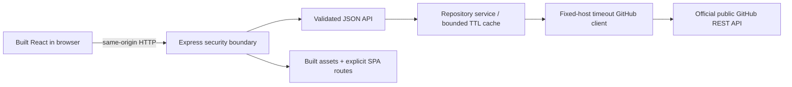
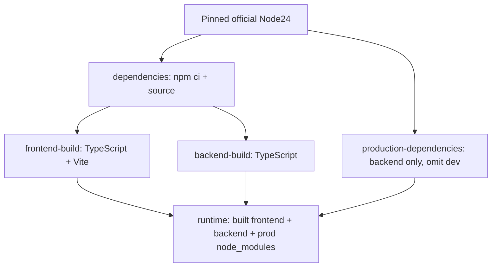

# Lesson 05: Production engineering, Docker, CI and evidence

## What changed and why

Phases1–4 delivered search, details and contribution issues. Phase5 packages that application as one production service, hardens its HTTP boundary and shutdown behavior, measures coverage, verifies real containers, and runs independent hosted checks. It also establishes `docs/PHASE_PROGRESS.md` as permanent repository-visible history.

This is a deployment-readiness phase. No host, image publication, paid service, merge or Phase6 deployment was activated. The owner's Issue7 comments now allow local/hybrid tools; Codex Cloud and GitHub remain the executed environments. A documented laptop command is not a claimed laptop result.

## 1. Actual files and responsibilities

| File / function                                               | What to explain                                                                                         |
| ------------------------------------------------------------- | ------------------------------------------------------------------------------------------------------- |
| `backend/src/app.ts`: `createApp`, `errorHandler`             | Compose boundary/API/static routes without starting a process; safe JSON errors; frontend-only fallback |
| `backend/src/security.ts`: `createBoundary`                   | Generated request IDs, headers/CSP, safe request/logging/admission limits                               |
| `backend/src/runtime.ts`: `startServer`, returned `shutdown`  | Asset preflight, listener/timeouts, readiness/draining and bounded graceful shutdown                    |
| `backend/src/server.ts`                                       | Validate settings, resolve production assets relative to the compiled entry, register SIGINT/SIGTERM    |
| `scripts/start-production.mjs`                                | Cross-platform root npm start selects production explicitly                                             |
| `Dockerfile`, `.dockerignore`                                 | Frozen dependency installation, parallel build stages, minimal non-root runtime, excluded context       |
| `compose.yaml`, `compose.cloud.yaml`                          | One read-only service; optional cloud CA/proxy overlay without embedding session files                  |
| `.github/workflows/engineering.yml`                           | Least-privilege hosted quality and Docker jobs; no publish/deploy                                       |
| `backend/src/production.test.ts`                              | Production routing/security/logging/rate/readiness/lifecycle tests                                      |
| `playwright.production.config.ts`, `tests/production.spec.ts` | Actual built Express-served UI at four widths and CSP enforcement                                       |
| `scripts/smoke-production.mjs`                                | Bounded startup readiness wait and HTTP/API/static/deep-link smoke                                      |
| `scripts/check-repository.mjs`                                | Tracked generated-file and common secret-pattern checks without exposing values                         |
| Vitest/Vite coverage configuration                            | V8 measurement scope and explicit thresholds                                                            |
| `docs/PHASE_PROGRESS.md` / `AGENTS.md`                        | Historical evidence provenance and permanent per-task reporting requirement                             |

See ARCHITECTURE, SECURITY, OPERATIONS, ADRs, DEPLOYMENT_READINESS and PHASE_5_VERIFICATION for detailed contracts and results.

## 2. Development and production are different workflows

During development, Vite serves React on5173 and forwards `/api` to Express3001. Its compiler/HMR conveniences do not become production infrastructure.

In production, both workspaces are built together. Express serves `frontend/dist` plus its existing JSON API; Node executes `backend/dist/server.js`. Root `npm start` calls `scripts/start-production.mjs`, which sets NODE_ENV=production before importing the compiled entry. It works across shell platforms without adding an environment-variable helper package.

Only `/` and valid `/repositories/:owner/:repo` paths receive the app HTML. A missing asset must be404, not HTML pretending to be JavaScript. An unknown API stays JSON404 even if the caller accepts HTML. Dotfiles are ignored and frontend files stay under the configured static root. Tests check these distinctions.

Built HTML uses revalidation/no-cache. Hashed Vite assets are immutable for a year because a changed build produces changed names. No backend token/settings are injected into browser assets. A single origin avoids adding permissive CORS or managing separately versioned frontend/backend releases.

## 3. Health and readiness must tell the truth

`/api/health` preserves the original liveness contract: this API process responds. `/api/ready` reports whether the process is draining and whether the production index exists. Startup also checks the index is readable.

Neither endpoint spends GitHub quota or guarantees upstream availability. A successful request to GitHub is a separate observation; rate limits can change afterward. Docker's healthcheck uses readiness so a started PID alone is not considered healthy.

Production tests verify the built page and assets too. Index presence is a deliberately narrow readiness check, not proof of every interaction or dependency.

## 4. Configuration, request boundaries and observability

PORT defaults to3001 and is validated1–65535. GITHUB_TIMEOUT_MS defaults to5000 and accepts100–30000 per upstream call. NODE_ENV selects the raw backend mode; root npm start always selects production. No `.env` auto-loader or secret is introduced.

The listener sets header/request/keepalive/inactivity limits. The API accepts GET/HEAD, no bodies, URLs at most4096 characters, and rejects declared bodies over16KiB. No body parser is needed for a read-only API. These are practical bounds, not a DDoS or parser-timing certification.

`createBoundary()` assigns a fresh UUID using `randomUUID()`. It ignores user-provided X-Request-ID and sends its own ID in the response. The finish log contains only event, ID, method, web/API surface, status and elapsed milliseconds. It does not log raw URL/query, owner/repo, body, IP, credentials or raw exceptions. Error logs use the same safe correlation principle. A test supplies sensitive-looking values and asserts they are absent.

The in-memory ingress limiter allows120 API reads/minute per direct IP, exempts health/readiness, and bounds its client table to1000 expiring entries. It returns safe429/503 retry guidance. `trust proxy` stays disabled so arbitrary forwarded-IP headers cannot choose a new identity. Behind a future verified proxy this may group clients together; Phase6 must assess the actual topology before changing trust.

This is separate from GitHub's general anonymous60/hour/IP and stricter search/secondary limits. Cache/admission limits do not create more upstream quota or coordinate replicas.

## 5. Graceful shutdown and lifecycle

A process receiving SIGTERM should stop taking new work, finish current work if possible, and exit predictably. `server.ts` registers signals; `startServer()` returns an idempotent shutdown function:

1. Mark the runtime draining so readiness becomes503.
2. Close the listener and idle connections.
3. Allow active requests to complete.
4. After ten seconds, close remaining connections and force exit1.
5. Normal completion clears the deadline and logs stopped.

Compose gives twelve seconds, slightly longer than the app's deadline. Tests create a stalled connection and verify the forced-deadline callback; actual Docker/Compose normal SIGTERM stops were observed exit0. Do not describe a killed process/exit137 as graceful success.

Browser cancellation is not guaranteed to cancel an already-started server/GitHub call. The existing upstream deadline still bounds that work; the process shutdown deadline is the final runtime bound.

## 6. HTTP security baseline

Production CSP uses self-only scripts/styles/connect, forbids objects/base/frame ancestors, and has no unsafe-inline/eval. Headers also set nosniff, DENY framing, no-referrer, disabled camera/microphone/geolocation, and same-origin resource policy. A real built-browser test appends an inline script and confirms it cannot set its marker.

No HTML/Markdown rendering, arbitrary upstream host, writable API, cookie/session or permissive CORS was added. Existing path/input/runtime/link validation remains in place. Static/API boundaries and read-only containers reduce exposure but do not prove the absence of all vulnerabilities.

HSTS is intentionally not sent on local HTTP. HTTPS termination, redirects, trust proxy and final transport policy belong to the chosen future host. npm audit covers reported npm advisories, not OS CVEs or complete supply-chain safety. The security document lists the actual threat scenarios, tests and residual risks.

## 7. Docker images, containers and multi-stage builds

An **image** is the packaged filesystem/configuration. A **container** is a running instance with a process/network/lifecycle. A successful image build does not prove its process can start as the configured user.

The Dockerfile uses a deliberately pinned official Node24 LTS Bookworm-slim index. The inspected index is `sha256:a5f4366e834695d5f363b920c104953a535d3a9864d1bdf74566a0ebe01daee5`; the tested amd64 image reports Node24.22.0. Cloud/CI Node24.19.0 and image Node24.22.0 both satisfy the project Node24 contract. Re-pin and rerun checks for security updates; a permanent stale digest is not maintenance.

Stages:

The lockfile and npm ci prevent silent dependency re-resolution. Builder stages need development tools, but the final runtime carries backend production dependencies and compiled assets only. It excludes test/source/docs/Git history/coverage/dev tools/session CA files. `.dockerignore` also keeps env/npm-auth/key/proxy and generated artifacts out of the context.

The optional BuildKit secret mount provides the cloud's public CA to npm **during** each networked installation. It is not copied into layers, and TLS stays enabled. Normal hosts/CI do not need the cloud overlay. Predefined proxy arguments are not converted into Docker ENV instructions. Do not solve TLS failures by disabling verification.

## 8. Non-root execution and a bug the real container found

The final image uses USER node (UID1000), root-owned application files and explicit read/execute modes. Compose adds read-only root filesystem, temporary `/tmp`, dropped capabilities, no-new-privileges, process/memory/CPU bounds.

The initial image built, then failed at startup because the copied backend package manifest was not readable by the non-root user. A first chmod-copy attempt also made the parent directory non-executable. The final Dockerfile explicitly sets backend directory755 and manifest644. Actual runtime checks then confirmed UID1000, EROFS when writing `/app`, healthy readiness and successful requests.

That is why image build, run, health, request, file permissions and stop are separate evidence. Never infer daemon availability from `docker --version`: local-socket `docker info` actually reported daemon28.4.0/vfs; Compose2.40.3 was also checked.

## 9. Ports, Compose and the cloud overlay

The process listens on PORT, default3001, on0.0.0.0 inside its container. Compose maps host loopback8080 to container3001. `EXPOSE 3001` documents the port; it does not publish it by itself. A separate run set container PORT4000 and mapped host8081→4000; the same health/API/UI/deep-link smoke passed.

One Compose service is enough: no DB or cache server is required. `up --wait` waits for the inherited Docker healthcheck. The smoke script additionally verifies actual HTML/assets and safe API404s. It has a bounded startup-readiness wait; this is local health waiting, not GitHub polling.

In Codex, Buildx's usual home was read-only; BUILDX_CONFIG under `/tmp` solved it without replacing Docker registry configuration. The cloud overlay mounts the provided CA read-only and enables Node's environment proxy support. Regular laptop/CI Compose uses the base file alone. Both cloud overlay and plain-host hosted CI Compose were actually executed.

The operations runbook contains exact commands for cloud and optional laptop verification. No Docker Desktop subscription/account is required by the project; use eligible free Engine/Compose or check Desktop's personal/education eligibility before choosing it.

## 10. CI, delivery and deployment are different

- **Continuous integration:** automated install/check/test/build when a branch changes.
- **Delivery readiness:** a reviewed, reproducible release candidate with evidence and runbooks.
- **Deployment:** publishing/running it on a public host. Not authorized in this phase.

`engineering.yml` runs on push/PR to main or feat/** with standard public Ubuntu runners. It grants contents:read, pins checkout/setup-node to verified SHAs, does not persist checkout credentials, cancels superseded runs, and has job time limits. No secrets, registry push, artifact upload/paid storage or deploy step is present.

The quality job runs frozen install, formatting/lint/types/tests/build, V8 coverage, tracked safety checks, npm audit, Chromium install and dev/production browser checks. The Docker job builds/runs plain Compose, waits for readiness, smokes HTTP, checks non-root/read-only behavior and exit0, then removes containers.

A push to the new branch ran successfully before any merge. Older stacked heads without the workflow do not automatically inherit these results; each run proves its own ref/event. Fork approvals/policies still apply. We do not assume workflow_dispatch works before a workflow reaches a default branch.

Actual run39051249057 passed quality/docker for implementation `5ebaca4e448c72c93056973c0279ad9cc58d4ebb`. Codex read job/step conclusions via GitHub API. Raw log download was forbidden at the results-receiver host; detailed counts/coverage quoted in our docs are cloud observations, not fabricated hosted-log observations. Open the linked run in GitHub to review its logs independently.

## 11. Test pyramid and measured coverage

The base is focused function/contract tests: validation, mapping, cache, URL/error/timeout behavior and state boundaries. Integration tests exercise real Express routes and runtime/static behavior. Browser tests verify user interaction, responsive layout/accessibility and actual built production serving. Container smoke tests verify packaging/process contracts. Each layer detects failures another layer can miss.

Cloud totals:81 frontend,154 backend,13 dev browser and5 production browser cases. Production tests cover360/390/768/1280, deep refresh, keyboard/focus, axe, no overflow, reduced motion, assets/API boundaries and CSP. Browser data mocks protect quota; real readiness/health/local invalid inputs avoid GitHub side effects.

Measured V8 totals: frontend lines97.33%, branches94.25%; backend lines97.93%, branches95.97%. Thresholds are90% lines/statements and85% branches/functions. Excluded startup entries/main mounting and fixtures/tests are documented; real production/container execution covers entry startup. Coverage reports identify gaps, not correctness or security certification. Runtime error/default-exit/capacity branches are not all exercised; do not turn aggregate percentages into an all-path claim.

`@vitest/coverage-v8@5.0.5` is the only added dev dependency; no runtime dependency was added. Audit returned zero reported npm findings in cloud; hosted audit step passed its configured threshold. Generated coverage HTML/logs stay ignored, with concise measured figures in versioned evidence.

## 12. Performance, readiness and truthful evidence

The measured built bundle is243.48kB JavaScript, gzip75.73kB; CSS6.55kB, gzip2.03kB. Those are build outputs, not latency/load capacity. Compose memory256MiB/CPU1/process100 limits are configured bounds, not proof of production throughput. No native/host cold-start/traffic benchmark or OS-CVE scan was performed.

DEPLOYMENT_READINESS uses PASS/BLOCKED/NOT TESTED for each gate. Cloud/hosted CI/container evidence supports engineering review. Owner review, host no-card/no-overage terms, TLS/proxy setup, optional/required native/image/performance follow-up and Phase6 authorization remain separate. No provider was activated or described as currently verified free from old terms.

PHASE_PROGRESS backfills Phases1–4 from their committed reports and actual open-PR metadata. It distinguishes Codex-reported tests from GitHub metadata/ChatGPT review. Every later implementation task must update that journal and its own verification report in the same commit(s). A final doc cannot contain its own commit hash: record the tested implementation SHA, explain a later evidence-only commit, and report final head separately.

## 13. Interview questions

1. **Why one origin?** It simplifies API routing, releases and browser security without permissive CORS.
2. **Why isn't a Docker build enough?** Runtime user permissions, ports, startup, health and signals are separate behaviors.
3. **What does multi-stage remove?** Build tools, dev dependencies and source/test/session files from the runtime stage.
4. **Why run non-root and read-only?** Reduce privilege and prevent application-file modification if the process is compromised.
5. **Liveness versus readiness?** A responding process versus the narrower conditions needed to accept service; neither proves GitHub quota.
6. **Why a shutdown deadline?** Give current work a chance to finish without hanging forever.
7. **Why avoid trusting forwarded IPs by default?** A caller could spoof them unless the exact trusted proxy chain is established.
8. **Does CSP replace output safety?** No; runtime link/data validation and safe text rendering still matter.
9. **What does high coverage prove?** Many measured paths executed under tests, not that all assertions/security requirements are correct.
10. **Why pin action/image versions?** Make dependency changes deliberate; refresh pins to receive fixes rather than freezing forever.
11. **Why CI success on an exact SHA?** Later commits/branches may differ; evidence needs a precise source ref and environment.
12. **Is CI/CD the same as deploying automatically?** No. This pipeline integrates and prepares delivery; publication is separately gated.

## 14. Practical cloud/laptop exercises

Use a separate practice branch and update its progress/verification evidence:

1. Follow a deep-link request through static routing and explain why an API404 must never become index.html.
2. Run a fresh local/cloud Compose sequence and separately record daemon, image, health, HTTP and stop outcomes.
3. Change container PORT and host mapping, predict the correct URL, and verify the dynamic healthcheck.
4. Deliberately remove the build index in a disposable copy and compare startup/readiness behavior.
5. Read the redacted request log and correlate its UUID to a response without revealing the query/IP.
6. Inspect V8 uncovered lines and propose one meaningful boundary test rather than a test that just repeats implementation constants.
7. Explain the Docker permission bug and why directory execute permission differs from file read permission.
8. Review the readiness table and identify evidence required before a genuinely free public deployment could be authorized.

This is AI-assisted implementation. Understanding/reviewing/reproducing/modifying the actual code and evidence are learning achievements; they do not justify claiming independent authorship, unexecuted device tests or production security certification.
